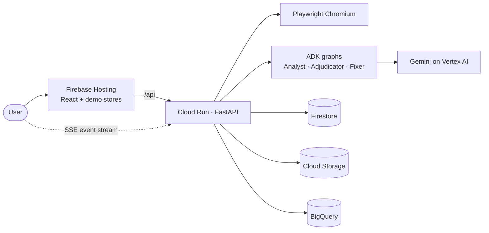
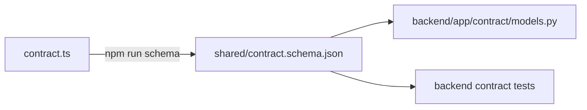

# AGENTS.md — Shop Honest

Guidance for AI coding agents (and humans) working in this repo. Prefer this file for day-to-day conventions; prefer [`docs/ARCHITECTURE.md`](docs/ARCHITECTURE.md) and the ADRs for *why* a design exists.

**Live:** <https://shop-honest-ai.web.app> · Google Cloud AI Builder Cup 2026 · Team Zero Context

---

## 1. What this project is

Shop Honest sends AI agents shopping like a real customer (product → variant → cart → checkout → payment) and reports every dark pattern it meets, with screenshot evidence, the rule it breaks (India CCPA Annexure 1 and six other jurisdictions), what it costs the shopper, and a fix.

Mental model:

1. **Measured checks** first (timers, stock, cart lines, fees, M.R.P. history) — no model required.
2. **Gemini** judges wording and design, but every claim must cite a measured page element.
3. An **Adjudicator** verifies claims (with tools) before anything is confirmed.
4. **Fix it** proposes settings changes on our demo stores, projects the numbers, and **Verify** re-audits a fixed copy to prove which fixes worked.

Non-goals: paying or placing orders; bypassing CAPTCHA / bot protection / sign-in walls; giving legal advice; changing real third-party sites.

Deep docs: [Architecture](docs/ARCHITECTURE.md) · [API](docs/API.md) · [Decisions](docs/decisions/README.md) · [Judging](docs/JUDGING.md) · [Evidence](docs/evidence/README.md)

---

## 2. Repository layout

```
shop-honest/
├── web/                 React 19 + Vite + TypeScript + Tailwind 4
│   └── src/
│       ├── auditor/     Dashboard, report, Fix it, PDFs, live SSE client
│       ├── store/       BazaarNest demo stores (A rigged / B honest / C wall)
│       └── shared/      contract.ts (source of truth) + patterns.ts
├── backend/             Python 3.12 · FastAPI · Playwright · Google ADK · uv
│   └── app/
│       ├── api/         REST + resumable SSE (`audits.py`)
│       ├── runner/      Audit ownership, budgets, ADK `audit` graph, walk
│       ├── agents/      Checks, Pattern Analyst, Evidence, Adjudicator,
│       │                Reporter, Fixer, review graph; prompts/*.md
│       ├── browser/     Playwright session, capture, signals.js, URL guard
│       ├── journeys/    Scripted BazaarNest + generic navigator
│       ├── models/      Provider factory (replay | ollama | gemini), ScriptedLlm
│       ├── stores/      Event log + frames (memory or Firestore/GCS)
│       ├── prices/      Price Historian (JSON file or BigQuery)
│       ├── contract/    Pydantic mirrors of the TypeScript contract
│       ├── replay/      Recorded event logs for "Scan it"
│       ├── config.py    Settings from environment variables
│       └── main.py      FastAPI app
│   ├── evals/           answer_key.py, dataset.py
│   ├── scripts/         record, seed_price_history, real_sites, …
│   └── tests/           unit, contract, browser, cloud, internet
├── shared/              Generated / exported reference data both sides read
│   ├── contract.schema.json   from `npm run schema`
│   ├── legal.json             from `npm run knowledge`
│   ├── patterns.json
│   ├── price_history.json
│   ├── answer_key.json
│   └── store_settings.json
├── deploy/              setup, Cloud Build → Cloud Run, monitoring, judging
└── docs/                ARCHITECTURE, API, JUDGING, decisions/, evidence/
```

---

## 3. Setup

**Prerequisites**

| Tool | Why |
|---|---|
| [uv](https://docs.astral.sh/uv/) | Installs Python 3.12 and runs the backend |
| Node.js (recent LTS) | Web app |
| Playwright Chromium | Live browser walks (`uv run playwright install chromium`) |
| Optional: Ollama + `gemma3:4b` | Local models (`MODEL_PROVIDER=ollama`) |
| Optional: `gcloud` + ADC | Gemini on Vertex / GCP stores (`gcloud auth application-default login`) |

**First run — dashboard only (no backend):**

```sh
cd web && npm install && npm run dev        # http://localhost:5173 · mock / offline demo
```

**First run — backend + live UI:**

```sh
cd backend
uv sync && uv run playwright install chromium
uv run uvicorn app.main:app --port 8080

# other terminal
cd web && npm install && npm run dev:live   # Vite proxies /api → http://127.0.0.1:8080
```

Use `127.0.0.1`, not `localhost`, for the proxy target: Node prefers IPv6 for localhost and uvicorn listens on IPv4 ([`web/vite.config.ts`](web/vite.config.ts)).

---

## 4. Common commands

### Backend (`cd backend`)

| Command | When to use |
|---|---|
| `uv sync` | Install / refresh deps |
| `uv run uvicorn app.main:app --port 8080` | Local API |
| `uv run pytest` | Default unit + contract tests (no live browser) |
| `uv run pytest -m browser` | Real Chromium walks of demo stores — needs `npm run build` in `web/` first |
| `uv run pytest -m cloud` | Real Firestore / GCS — set `SHOP_HONEST_CLOUD_TESTS=1` + ADC |
| `uv run pytest -m internet` | Real third-party sites — set `SHOP_HONEST_INTERNET_TESTS=1` |
| `uv run ruff check .` | Lint (line-length 130; see §7) |
| `uv run python -m evals.answer_key --provider gemini --runs 2` | Accuracy vs `shared/answer_key.json` (stores A/B/C) |
| `uv run python -m evals.dataset [--limit 200]` | Public ec-darkpattern text eval |
| `MODEL_PROVIDER=gemini uv run python -m scripts.record store-a store-b store-c` | Re-record "Scan it" replays after agent changes |
| `… scripts.record … --publish` | Copy recordings + frames into the committed paths |
| `uv run python -m scripts.seed_price_history` | Seed BigQuery demo price history (re-run before judging) |
| `uv run python -m scripts.real_sites URL … [--provider ollama\|gemini]` | Logged-out audit of a public product page (for human review) |

### Web (`cd web`)

| Command | When to use |
|---|---|
| `npm run dev` | Offline / mock dashboard |
| `npm run dev:live` | Dashboard against local backend (`VITE_AUDIT_SOURCE=live`) |
| `npm run build` | Production build (`tsc -b` + Vite); also required before `pytest -m browser` |
| `npm run test` | Vitest |
| `npm run typecheck` | `tsc -b` |
| `npm run lint` | oxlint |
| `npm run schema` | Regenerate `shared/contract.schema.json` from `contract.ts` |
| `npm run knowledge` | Export legal / patterns / answer key / store settings / price history into `shared/*.json` |
| `npm run recordings` | Export recording assets for the web app |
| `npm run capture` | Capture demo-store screenshots used by the mock |

---

## 5. Architecture in brief



### Agents (one job each; runner wires them)

| Agent | Job | Model |
|---|---|---|
| **Navigator** | Reach each journey step; capture screenshot + signals | None on demo stores; Flash on unknown sites |
| **Measured checks** (`agents/checks.py`) | Timers, stock, sneaked cart lines, pre-ticked subs, late fees | None |
| **Price Historian** (`prices/`) | M.R.P. vs ≥ 8 weeks of history | None (BigQuery / JSON) |
| **Pattern Analyst** | Wording / design candidates citing element refs `e1, e2…` | *smart* tier |
| **Evidence** | Ground candidates on measured boxes; drop contradictions | None |
| **Adjudicator** | Score / confirm / review / drop; may call evidence tools | *fast* tier |
| **Reporter** | Trust score, money, exposure, CCPA self-audit | None (deterministic) |
| **Fixer** | Per-finding fix proposal (`setting` / `code` / `review`) | Gemini |

Two ADK `Workflow` graphs ([ADR-0014](docs/decisions/0014-audit-as-adk-workflow.md)):

- `audit` — [`backend/app/runner/audit_graph.py`](backend/app/runner/audit_graph.py): navigate → collect reviews → summarise → report
- `screen_review` — [`backend/app/agents/review_graph.py`](backend/app/agents/review_graph.py): prepare → analyse → ground → adjudicate

`AGENT_GRAPH=false` runs the same steps in plain Python.

### Event ordering (enforced in tests)

- `audit.started` first; exactly one terminal event (`audit.completed` or `audit.failed`) last.
- Within a step: `step.started` → captures / logs → `price.observed` → findings.
- `step.blocked` ends the walk — no later `step.started`.

---

## 6. The contract workflow (read before changing any payload)

[`web/src/shared/contract.ts`](web/src/shared/contract.ts) is the **single source of truth** for every API payload and event ([ADR-0006](docs/decisions/0006-contract-source-of-truth.md)).



When you change a type, field, or event name:

1. Edit `web/src/shared/contract.ts`.
2. Run `cd web && npm run schema`.
3. Mirror the change in `backend/app/contract/models.py` (Pydantic).
4. Update emitters (runner / agents) and consumers (web `auditor/source`, report UI).
5. Run `cd backend && uv run pytest tests/test_contract.py` (and the relevant unit tests).

Never let TypeScript and Pydantic drift. Every event the backend emits must validate against the schema.

---

## 7. Coding conventions

### Python (`backend/`)

- Python **3.12** only (`requires-python = ">=3.12,<3.13"`).
- Package manager: **uv**. Run everything via `uv run …`.
- Lint: **ruff** — line-length **130**, selects `E,F,I,B,UP,ASYNC,RUF`. Typographic dashes and arrows in user-facing text are intentional (`RUF001` / `RUF002` ignored).
- Settings: [`app/config.py`](backend/app/config.py) via `pydantic-settings` (env vars; optional `backend/.env`).
- Agent prompts live as Markdown under [`app/agents/prompts/`](backend/app/agents/prompts/) and are passed as ADK `static_instruction` (cacheable; no templating of the system prompt).
- Model IDs are **configuration**, not code (`GEMINI_MODEL_FAST`, `GEMINI_MODEL_SMART`, …).
- Prefer measured / deterministic code over another model call when the fact is measurable ([ADR-0008](docs/decisions/0008-measured-checks-before-judgement.md)).
- Structured model output: validate against a Pydantic schema (`models/call.py`); retry once on invalid JSON; a failed screen review must not fail the whole audit.

### TypeScript / React (`web/`)

- React **19**, Vite **8**, TypeScript (project references via `tsc -b`), Tailwind **4**, oxlint, Vitest.
- Tests sit next to source: `foo.test.ts` beside `foo.ts`.
- Live vs mock: `AuditSource` in [`web/src/auditor/source/`](web/src/auditor/source/) — production uses SSE (`sseSource.ts`) with a demo fallback when the API is unreachable.
- PDFs are built **in the browser** with `@react-pdf/renderer` ([ADR-0007](docs/decisions/0007-client-side-pdf.md)) — do not add a server-side PDF path.
- Preserve the existing visual language of the auditor and BazaarNest stores; do not invent a new design system for small fixes.

### Shared reference data

| Edit in | Then run | Writes |
|---|---|---|
| `web/src/shared/contract.ts` | `npm run schema` | `shared/contract.schema.json` |
| `web/src/auditor/mock/legal.ts`, `patterns.ts`, `store/answerKey.ts`, `store/settings.ts`, `store/catalog.ts`, … | `npm run knowledge` | `shared/legal.json`, `patterns.json`, `answer_key.json`, `store_settings.json`, `price_history.json` |

Commit regenerated `shared/*` files with the source change that produced them.

---

## 8. Testing conventions

| Marker / suite | Needs | Proves |
|---|---|---|
| Default `pytest` | Nothing extra | Units, contract validation, scripted models |
| `-m browser` | `web/` built (`npm run build`); Playwright Chromium | Live walks of demo stores / fixtures |
| `-m cloud` | `SHOP_HONEST_CLOUD_TESTS=1` + ADC | Firestore / Cloud Storage |
| `-m internet` | `SHOP_HONEST_INTERNET_TESTS=1` | Real third-party pages |
| Vitest (`npm run test`) | `cd web` | Projection, score, self-audit, SSE helpers, scripts |

**Rules**

- Unit tests that need a model use **`ScriptedLlm`** ([`backend/app/models/scripted.py`](backend/app/models/scripted.py)) — no network, no API key.
- Fixtures under `backend/tests/fixtures/` are real signal captures; prefer them over hand-waved HTML.
- Golden replay recordings should stay stable across unrelated releases; if you change agent behaviour, re-record deliberately (§12).
- Event-ordering and schema invariants are not optional — keep the tests green.
- Answer-key targets (measured on Gemini): **Store A 9/9** (borderline claim → `needs_review`), **Store B 0** false alarms, **Store C 6/6** then honest stop at the wall. Findings that are real but not what a planted trick was for may appear in `ALSO_ACCEPTABLE` and count as neither hits nor false alarms.

---

## 9. Safety and honesty invariants (non-negotiable)

These are product requirements, not style preferences. Breaking them fails the demo and the trust story.

**Click guard — the navigator must never:**

- Pay, buy now, confirm an order, sign in, register, subscribe, or accept terms
- Type into fields
- Press another product's button or a disabled control

**URL guard / SSRF** ([ADR-0005](docs/decisions/0005-allowlist-and-safety.md)):

- Only `http` / `https`
- Resolve DNS; reject private, loopback, link-local, and cloud metadata ranges
- Re-check after every redirect and navigation (Playwright request interception)

**Honesty:**

- Never bypass CAPTCHA or bot protection — stop and report `step.blocked`.
- A step counts only once the page actually shows it (cart lines / bill / checkout / wall).
- A page where nothing could be checked gets **no trust score**, only the reason.
- Unverifiable claims → `needs_review` (human), not confirmed.
- On third-party sites, layout-dependent measured findings (sneaked items, pre-ticked options, late fees) go to **human review**, not hard assertions ([ADR-0013](docs/decisions/0013-general-navigator-on-third-party-stores.md)).
- Reports on real platforms are **automated observations, not legal findings**.

**Fix it** ([ADR-0015](docs/decisions/0015-fix-and-verify.md)):

- Settings patches apply only to **our** demo stores, and only inside the auditor browser's `sessionStorage` copy — nobody else sees them; real sites are never mutated.
- Each proposed setting change must map to a dark-pattern kind that setting is allowed to fix (`shared/store_settings.json`).
- For other sites: ship the fix list + **Re-audit this page** (`compareTo`), never `applyFixes`.

---

## 10. Budgets and limits

Configured in [`backend/app/config.py`](backend/app/config.py) / env (production: [`deploy/backend.env.yaml`](deploy/backend.env.yaml)).

| Limit | Typical value | On breach |
|---|---|---|
| Model calls per audit | 40 (`AUDIT_MAX_MODEL_CALLS`) | Stop judging; report grounded findings |
| Model tokens per audit | 400k (`AUDIT_MAX_TOKENS`) | Same |
| Wall-clock per audit | 360 s (`AUDIT_TIMEOUT_S`) | `audit.failed` with a clear reason |
| Concurrent live browsers | 2 per instance (`MAX_LIVE_AUDITS`) | Queue / reject |
| Live audits per day (site-wide) | 100 in production (`LIVE_PER_DAY`) | `429 rate_limited` |
| Live audits per visitor / hour | 0 = unlimited in production (`LIVE_PER_IP_PER_HOUR`) | — |
| Confirm / drop thresholds | ≥ 0.75 confirm; < 0.35 drop (`REVIEW_THRESHOLD`, `REJECT_BELOW`) | — |

Replays ("Scan it") are unlimited and free. Do not raise production budgets casually — they protect cost and demo fairness.

---

## 11. Environment variables

Essential knobs (full list: Architecture §13). Names are uppercase env vars mapping to `Settings` fields in `config.py`.

| Variable | Values | Purpose |
|---|---|---|
| `MODEL_PROVIDER` | `replay` · `ollama` · `gemini` | Which models agents use (`replay` = measured-only for live) |
| `GEMINI_BACKEND` | `vertex` · `ai_studio` | Vertex (ADC / SA) or AI Studio key |
| `GOOGLE_CLOUD_PROJECT` / `GOOGLE_CLOUD_LOCATION` | `shop-honest-72fd8` / `global` | Vertex project; global endpoint |
| `GEMINI_MODEL_FAST` / `GEMINI_MODEL_SMART` | e.g. `gemini-3.6-flash` | Adjudicator / Pattern Analyst tiers |
| `GEMINI_MODEL_FALLBACK` | e.g. `gemini-3.1-flash-lite` | Capacity fallback |
| `AGENT_GRAPH` | `true` · `false` | ADK workflows vs plain Python steps |
| `OLLAMA_BASE_URL` / `OLLAMA_MODEL` | `http://127.0.0.1:11434` / `gemma3:4b` | Local models |
| `STORE_BACKEND` | `memory` · `gcp` | In-process log + local frames, or Firestore + GCS |
| `PRICE_HISTORY_BACKEND` | `json` · `bigquery` | Demo catalog file vs BigQuery |
| `FRAMES_BUCKET` / `BQ_DATASET` | `shop-honest-72fd8-audits` / `shop_honest` | Cloud resource names |
| `ENABLE_LIVE` / `MAX_LIVE_AUDITS` | `true` / `2` | Live audits on/off; browsers at once |
| `ALLOWED_HOSTS` | `*` or host list | Sites that may be audited |
| `ALLOW_PRIVATE_TARGETS` | `true` locally / `false` prod | Localhost / private IPs for allowlisted hosts |
| `LIVE_PER_DAY` / `LIVE_PER_IP_PER_HOUR` | `100` / `0` in prod | Rate limits |
| `CORS_ORIGINS` | e.g. `http://localhost:5173` | Dev CORS |
| `AUDIT_MAX_MODEL_CALLS` / `AUDIT_MAX_TOKENS` / `AUDIT_TIMEOUT_S` | `40` / `400000` / `360` | Per-audit budgets |
| `REVIEW_THRESHOLD` / `REJECT_BELOW` / `ADJUDICATOR_VERIFY` | `0.75` / `0.35` / `true` | Judgement gates |
| `NAV_LINGER_S` / `NAV_STEP_TIMEOUT_S` | `8` / `15` | Product-page second look; per-action timeout |

**Web:** `VITE_AUDIT_SOURCE=live` uses the backend; `VITE_STREAM_BASE` is the Cloud Run URL for the event stream in production ([ADR-0010](docs/decisions/0010-event-stream-straight-to-cloud-run.md) — Hosting buffers SSE).

---

## 12. Workflow recipes

### Change an agent or prompt

1. Edit code under `backend/app/agents/` and/or `agents/prompts/*.md`.
2. Cover behaviour with `ScriptedLlm` unit tests where possible.
3. Run `uv run pytest` (and `-m browser` if navigation / capture changed).
4. If judgement quality may have moved: `uv run python -m evals.answer_key --provider gemini --runs 2`.
5. If the public "Scan it" story should reflect the new behaviour: re-record with `scripts.record` and `--publish`, then check against the answer key.
6. Do not invent README accuracy numbers — only update them when `docs/evidence/` has a fresh measured run.

### Add a measured check

1. Implement in [`backend/app/agents/checks.py`](backend/app/agents/checks.py) using signals from `browser/signals.js`.
2. Add positive **and** honest-negative tests in `tests/test_checks.py`.
3. Ensure findings carry screenshot evidence and a pattern id from the shared taxonomy.
4. If the pattern catalogue or answer key changes, update the TS sources and run `npm run knowledge`.

### Add or change an API event / field

Follow §6 (contract workflow). Update [`docs/API.md`](docs/API.md) if the public surface changes.

### Touch shared reference data

Edit the TypeScript sources of truth, then `npm run knowledge` (and/or `npm run schema`). Do not hand-edit generated `shared/*.json` unless you know why.

### New architectural decision

Add the next numbered file under [`docs/decisions/`](docs/decisions/) and a row in that folder's `README.md`. Keep ADRs short: context, decision, consequences.

### README / pitch numbers

Every number claimed in the README must be **measured** on a dated run, with raw results under [`docs/evidence/`](docs/evidence/). Do not round estimates into "measured" rows.

---

## 13. Deploy and operations

GCP project `shop-honest-72fd8`, region `asia-south1` (Gemini on the **global** endpoint).

```sh
deploy/setup.sh                                                 # once: APIs, Firestore, bucket, BQ, registry, SA
(cd backend && uv run python -m scripts.seed_price_history)    # demo price history
deploy/backend.sh                                               # Cloud Build → Cloud Run (image tagged with commit)
npx firebase-tools deploy --only hosting                        # web
uv run --project backend python deploy/monitoring.py setup      # email alerts
uv run --project backend python deploy/preflight.py             # end-to-end check before a demo
deploy/judging.sh on | off                                      # warm instance + uptime probe for judging days
```

Rollback: Cloud Run keeps prior revisions; Artifact Registry keeps the newest images. See [ARCHITECTURE §11](docs/ARCHITECTURE.md#11-reliability-and-cost-controls).

Ownership / takeover: the instance running an audit heartbeats every 10 s; after 45 s of silence another instance may claim it ([ADR-0011](docs/decisions/0011-audit-ownership-and-takeover.md)). Replays resume; live audits fail closed.

---

## 14. Where to look things up

| Question | Look here |
|---|---|
| How the system fits together | [`docs/ARCHITECTURE.md`](docs/ARCHITECTURE.md) |
| Request / response shapes | [`docs/API.md`](docs/API.md), [`web/src/shared/contract.ts`](web/src/shared/contract.ts) |
| Why we chose X | [`docs/decisions/`](docs/decisions/README.md) (ADR-0001 … 0015) |
| Judging-day runbook | [`docs/JUDGING.md`](docs/JUDGING.md) |
| Measured evidence for claims | [`docs/evidence/`](docs/evidence/README.md) |
| Settings / env defaults | [`backend/app/config.py`](backend/app/config.py), [`deploy/backend.env.yaml`](deploy/backend.env.yaml) |
| Demo store tricks / answer key | [`web/src/store/answerKey.ts`](web/src/store/answerKey.ts), `shared/answer_key.json` |
| Fixable settings | [`web/src/store/settings.ts`](web/src/store/settings.ts), `shared/store_settings.json` |
| Legal map | `shared/legal.json` (exported from `web/src/auditor/mock/legal.ts`) |

---

## 15. Quick don'ts

- Don't change real third-party sites, or claim Fix-it mutated them.
- Don't bypass walls, CAPTCHAs, or bot protection.
- Don't confirm a finding without grounded evidence (or mark it `needs_review`).
- Don't edit `shared/contract.schema.json` or most `shared/*.json` by hand — regenerate.
- Don't hard-code Gemini model IDs in agent code — use settings.
- Don't skip contract tests after payload changes.
- Don't update README metrics without new evidence under `docs/evidence/`.
- Don't commit secrets (`.env`, API keys, ADC). Production credentials live in Secret Manager / the Cloud Run service account.
