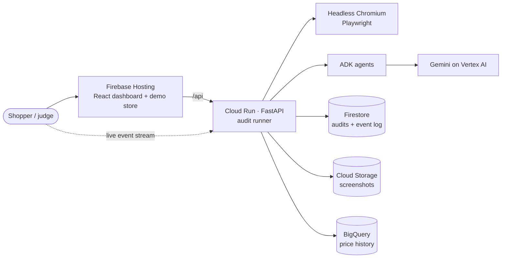

# Shop Honest

**Dark patterns? Caught in 4K.** Shop Honest sends AI agents shopping like a real customer, from product page to cart to checkout to payment, and reports the dark patterns it finds. Each finding comes with screenshot evidence, the exact rule it breaks under India's CCPA dark-pattern guidelines (and six other jurisdictions), how much more the shopper actually pays, and a specific fix.

**Live: <https://shop-honest-ai.web.app>** · Google Cloud AI Builder Cup 2026 · Retail & Commerce

## Try it
- **Scan it** on a sample store replays a recorded real run of the agents: instant, free and unlimited.
  - **Store A** is rigged with 8 tricks plus 1 borderline claim.
  - **Store B** is the honest control.
  - **Store C** hides checkout behind a sign-in wall.
- **Run live** sends a fresh browser and Gemini through the store while you watch: screenshots stream in, the agents narrate, and findings land as they're decided. It takes about a minute, with up to 3 live runs per visitor per hour.
- **A real store, logged out:** the chips under the URL box run the general navigator on stores we didn't build.
  - **AutomationExercise:** reaches the cart and stops honestly at the login wall.
  - **Flipkart, best effort:** reaches the cart if the site allows automated browsers, and otherwise says so instead of getting around it.
- **The report:**
  - **The money:** "they said you save ₹2,500, you really save ₹100", and the bill growing from ₹1,499 to ₹1,894.
  - **The law:** which rule each finding breaks, by country.
  - **The fixes**, and a downloadable PDF.

## How it works



- **Navigator** walks the journey in a real browser: a scripted route for the demo stores, a general navigator for other stores. It never pays, signs in, registers, types or accepts terms, and it stops at sign-in walls and bot protection.
- **Measured checks** catch what can be measured from the page:
  - a countdown that restarts on reload;
  - stock that never moves;
  - items added to the cart unasked;
  - pre-ticked paid subscriptions;
  - fees that first appear at payment.
- **Price Historian** looks the product up in **BigQuery** and flags an MRP it never actually sold at. Every audit adds the prices it saw.
- **Pattern Analyst** (Gemini) judges wording and design: shaming opt-outs, lopsided buttons, unverifiable claims. It can only cite elements measured on the page. The evidence rules and the **Adjudicator** (a second Gemini call, on a crop of the evidence) drop anything the measurements contradict. Claims nobody can check go to a **human review** queue instead of being asserted.
- **Reporter** builds the trust score, the money breakdown and the legal exposure.

Details: [Architecture](docs/ARCHITECTURE.md) · [API](docs/API.md) · [Decision records](docs/decisions/README.md) · [Judging runbook](docs/JUDGING.md)

## Results
| Evaluation | Result |
|---|---|
| **Planted tricks** (`evals/answer_key.py`, live runs, 2 per store) | Store A **9/9**, with the borderline claim in review · Store B **0 false alarms** · Store C **6/6** before its wall |
| **Public dataset** (`evals/dataset.py`): 2,356 shopping texts, [Yada et al. 2022](https://github.com/yamanalab/ec-darkpattern) on Mathur et al. 2019 | **Zero-shot**: accuracy **0.963**, precision **0.998**, recall 0.929, F1 **0.962**. For reference, models *trained on this dataset* reach 0.960–0.975 F1 |
| **Real stores, logged out** | AutomationExercise: product → cart → stops at the sign-in wall. Flipkart: reaches the cart page, which then refuses automated browsers; reported honestly |

All numbers come from `gemini-3.8-flash`. Equally accurate on our eval, it beat `gemini-2.5-pro` and `gemini-3.1-pro-preview` on cost. A live audit uses about 17k input and 5k output tokens.

## Built on Google Cloud
- **Gemini on Vertex AI**, via the **Agent Development Kit (ADK)**.
- **Cloud Run** (`asia-south1`), built with **Cloud Build** and stored in **Artifact Registry**.
- **Firestore** for audits and the resumable event log; **Cloud Storage** for screenshots; **BigQuery** for price history.
- **Firebase Hosting** for the site; **Cloud Monitoring** for alerts; **Cloud Billing** budgets.

## Honest limitations
- **General navigation is heuristic, with Gemini as a fallback.** Big retailers often block automated browsers, and we never bypass bot protection. Logged-out audits stop at sign-in, so checkout and payment on real stores are usually out of reach.
- **On sites we haven't validated, checks that depend on page layout go to human review** rather than being asserted: sneaked cart items, pre-ticked options and late fees.
- **MRP claims need at least 8 weeks of price history.** A new product isn't judged until audits have built it up.
- **Findings are automated observations, not legal advice.** The legal section shows which rules such patterns fall under.

## Run it locally
**The dashboard on the built-in demo** (no backend needed):

```sh
cd web && npm install && npm run dev        # http://localhost:5173
```

**The backend** needs [uv](https://docs.astral.sh/uv/), which installs Python 3.12 for you:

```sh
cd backend
uv sync && uv run playwright install chromium
uv run pytest                               # browser tests need `npm run build` in web/ first
uv run uvicorn app.main:app --port 8080     # then: cd web && npm run dev:live
```

| Setting | Effect |
|---|---|
| `MODEL_PROVIDER=gemini` | Gemini on Vertex AI, using your `gcloud auth application-default login` (no key) |
| `MODEL_PROVIDER=ollama` | Gemma 3 4B locally (`ollama pull gemma3:4b`) |
| `MODEL_PROVIDER=replay` (default) | No model: measured checks only |
| `STORE_BACKEND=gcp` / `PRICE_HISTORY_BACKEND=bigquery` | The real Firestore, Cloud Storage and BigQuery instead of local stand-ins |

**Evals:**
- `uv run python -m evals.answer_key --provider gemini --runs 2`
- `uv run python -m evals.dataset [--limit 200]`

**Web scripts:** `npm run schema`, `recordings`, `knowledge`, `capture`, `test`, `typecheck`, `lint` and `build`; see `web/package.json`.

## Deploy

```sh
deploy/setup.sh                                               # once: APIs, Firestore, bucket, BigQuery, registry, service account
(cd backend && uv run python -m scripts.seed_price_history)  # demo price history (re-run before judging)
deploy/backend.sh                                             # Cloud Build → Cloud Run, image tagged with the commit
npx firebase-tools deploy --only hosting                      # the site
uv run --project backend python deploy/monitoring.py setup    # once: email alerts on errors and 5xx
uv run --project backend python deploy/preflight.py           # before a demo: end-to-end checks on the live site
deploy/judging.sh on | off                                    # judging days: warm instance, higher limits, uptime probe
```

Project `shop-honest-72fd8`, region `asia-south1`. Rollback is in [ARCHITECTURE §11](docs/ARCHITECTURE.md#11-reliability-and-cost-controls).

```
shophonest/
├── web/        React app: dashboard, report, PDF, the BazaarNest demo store
├── backend/    FastAPI, audit runner, Playwright navigators, measured checks, ADK agents, evals
├── shared/     the contract schema and reference data shared by both (legal rules, patterns, answer key)
├── deploy/     setup, deploy, monitoring, judging mode, pre-flight
└── docs/       architecture, API, decision records, judging runbook
```

## Credits
- Dark-pattern taxonomy and research: Mathur et al., "Dark Patterns at Scale" (CSCW 2019).
- Evaluation dataset: Yada et al., "Dark patterns in e-commerce: a dataset and its baseline evaluations" (IEEE BigData 2022), Apache-2.0. It's downloaded at evaluation time, not redistributed here.
- Regulation: Central Consumer Protection Authority, *Guidelines for Prevention and Regulation of Dark Patterns, 2023*.
