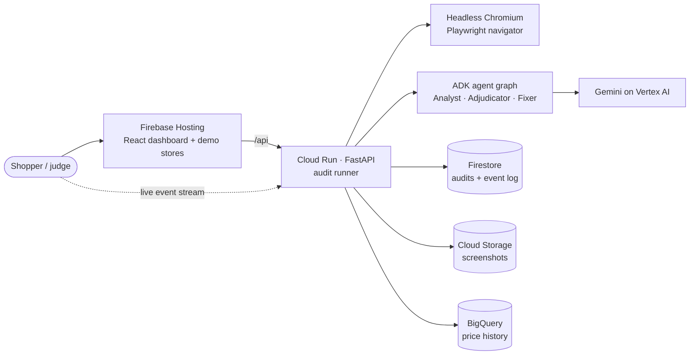

# Shop Honest

**Dark patterns? Caught in 4K.**

AI agents shop like a real customer — product → variant → cart → checkout → payment — and report every dark pattern they meet: screenshot evidence, the rule it breaks (India CCPA + six other jurisdictions), what it costs the shopper, and a fix. **Fix it** applies the changes to a copy of the store and re-audits to prove they worked.

[Open the live app](https://shop-honest-ai.web.app) · [Architecture](docs/ARCHITECTURE.md) · [API](docs/API.md) · [Slide deck](Zero%20Context%20-%20Shop%20Honest%20-%20AI%20Builder%20Cup.pptx)

[](https://github.com/saubhagyaashish/shop-honest/actions/workflows/web.yml)
[](https://shop-honest-ai.web.app)


Built for the Google Cloud AI Builder Cup 2026 · Retail & Commerce · Team Zero Context

> In November 2025, 26 Indian e-commerce platforms declared themselves free of dark patterns. In August 2026 the CCPA fined nine platforms, including Zepto, one of the 26, for a handling fee added during checkout and a membership put in the cart (Zepto says the fees were disclosed). A self-declaration isn't an audit. Shop Honest is the audit: it checks the whole journey the way a shopper meets it, measures what it can, and proves each fix.

## Judges: start here (3 minutes)
1. **See an audit.** Open the site and press **Scan it** on **Store A** (a replay of a real run by the agents: instant, free). Press **Skip to report**. You'll see:
   - **9 dark patterns**, each with its screenshot and the rule it breaks;
   - the bill growing from **₹1,499 to ₹1,894**;
   - "they said you save ₹2,500, you really save ₹100".
2. **Fix it.** Press **Fix it** on the report, then **Apply all**.
   - **Projected:** the trust score, the hidden extras, the fine ceiling and the CCPA patterns found move as you switch fixes on.
   - **Verified:** press **Verify**. The agents audit a fixed copy of the store live (about a minute) and mark each finding *Gone* or *Still there*.
3. **A real store.** Paste any public product page, or use a chip under the URL box. The agents shop it logged out. They stop honestly at a sign-in wall or bot protection, and say what they couldn't see, instead of calling the page "clean".

## What's new here
- **The whole journey, in a real browser.** Most tools scan one page or a piece of text. The agents add to cart, open the cart, start checkout, reload to catch restarting timers, and compare the cart with what was added.
- **Measured, then judged, then checked.** Code measures what can be measured: timers, stock, cart lines, fees, the M.R.P. against real price history. Gemini judges wording and design, but every claim must cite an element measured on the page. A second agent then checks the evidence with tools before anything is confirmed.
- **Fix and prove it.** A Fixer agent proposes a fix for each finding. You see what each fix is worth before applying it, and a re-audit of a fixed copy proves which ones worked. Real sites are never changed: their developers get the fix list and a re-audit.
- **A real CCPA self-audit.** All 13 patterns of the guidelines' Annexure 1, each marked found, clear, not reached or not assessable automatically, with the evidence, downloadable as a PDF.
- **Honest by construction.** Unsure claims go to a human. Findings on sites we didn't build that rest on page layout go to review. A page the agent couldn't check gets no score at all.

## Results
Every number below was measured, on the date shown; the raw results are in [`docs/evidence/`](docs/evidence/README.md).

| What | Result | Status |
|---|---|---|
| **Rigged store** (Store A: 8 planted tricks + 1 borderline claim) | **9/9** caught, the borderline claim sent to human review, in **3 of 3** live runs | MEASURED · `gemini-3.6-flash` · 15–16 Oct · [evidence](docs/evidence/answer-key-2026-10-16.json) |
| **Honest control store** (Store B) | **0** false alarms in 3 of 3 runs | MEASURED · same runs |
| **Sign-in wall store** (Store C) | **6/6** caught before the wall, then an honest stop | MEASURED · same runs |
| **Fix it, verified** (Store A) | **9 of 9** fixes verified on a fixed copy: trust score **16 → 100**, the shopper pays **₹1,596** instead of **₹1,894** | MEASURED · live re-audit on Gemini, 16 Oct; also a browser test, `test_live.py` |
| **Public dataset**: 2,356 shopping texts, [Yada et al. 2022](https://github.com/yamanalab/ec-darkpattern) | **Zero-shot** F1 **0.959**, precision **0.997** (3 false alarms), recall 0.924, accuracy 0.961. Models *trained on this dataset* reach 0.960–0.975 F1 | MEASURED · 15 Oct · [evidence](docs/evidence/dataset-2026-10-15.json) |
| **Real platforms**: 6 of the 26 self-declared, logged out | Two reached the cart; each fee there that the product page didn't show went to review (Flipkart's ₹10 platform fee, Tata 1mg's ₹12 handling charge). Four stopped and said why: an empty page, a refused connection, bot protection, a product out of stock. None was called "clean" | MEASURED · local Gemma · 16 Oct · [evidence](docs/evidence/real-sites-2026-10-16.md) |
| **Speed and tokens** | A Store A audit takes about **27 s**, using **21k input + 5k output** tokens | MEASURED · 16 Oct |
| **Tests** | **213** backend tests (including live browser walks of the demo stores and of copies of real-site pages) and **44** web tests pass | MEASURED · 16 Oct |
| **Cost** | About **₹2** per live audit; replays, and Fix it on a replay, cost nothing | ESTIMATE (₹1.5–2 was measured on `gemini-3.8-flash`) |

`gemini-3.6-flash` was as accurate as `gemini-3.8-flash`, `gemini-2.5-pro` and `gemini-3.1-pro-preview` on the demo stores (9/9, 0 false alarms, 6/6), and the fastest, so it runs both tiers, with `gemini-3.1-flash-lite` as the fallback. Every layer counts on Store A: measured checks alone catch 6/9, adding local Gemma 3 4B gets 8/9, and adding Gemini gets 9/9.

## What is real and what is simulated
- **The demo stores are ours (BazaarNest).** We built them to plant known tricks and score the agents against an answer key.
  - **Store A** plants the kinds of tricks the CCPA fined in 2026: fees added late in the journey and an add-on put in the cart (Zepto), pre-selected extras (Physics Wallah, BookMyShow), and shaming opt-out wording (IndiGo).
  - **Store B** is the same store with none of them.
  - **Store C** is Store A behind a sign-in wall.
- **"Scan it" replays are recordings of real live runs** by the agents on Gemini, not mock-ups, with the Fixer's plan recorded too. "Run live" runs the agents for real.
- **The demo catalog's 26-week price history is seeded** (SYNTHETIC), so the M.R.P. check has history to compare with. Real products build their own history in BigQuery from each audit.
- **Fix it changes only our own demo stores, and only a copy in the auditor's browser.** The store reads the patch before it renders, and nobody else sees it. On any other site nothing is ever changed: you get the fix list and **Re-audit this page**.
- **Real sites are audited logged out, as a shopper who hasn't signed in.** Findings there are automated observations for review, not legal findings.

## How Gen AI is used
| Job | Done by |
|---|---|
| Walking the journey: finding "Add to cart", the cart, checkout | Code (Playwright), with a click guard. Gemini picks a control only when the wording doesn't identify it |
| Timers, stock, cart contents, pre-ticked boxes, fees, M.R.P. history | Code: measured checks and the Price Historian (BigQuery) |
| Wording and design: shaming, lopsided buttons, unsourced claims | **Gemini** (Pattern Analyst), citing only elements measured on the page |
| Checking each claim | **Gemini** (Adjudicator), with tools to measure the cited elements and reload the page; code rules drop claims the measurements contradict |
| Fixes | **Gemini** (Fixer) proposes. Code checks each change: it must use a setting meant for that kind of dark pattern. The re-audit verifies it |
| Trust score, the money, the law, the CCPA self-audit | Code (Reporter) |

The live audit runs as **ADK agent graphs** (`Workflow`, [ADR-0014](docs/decisions/0014-audit-as-adk-workflow.md)): navigate → review each screen (analyse → ground → adjudicate) → summarise → report. The Fixer runs on demand from the report ([ADR-0015](docs/decisions/0015-fix-and-verify.md)).

## How it works



- **Navigator.** A scripted route for the demo stores, and a general navigator for any other store.
  - **Never:** pays, signs in, registers, types, accepts terms, or presses another product's button.
  - **Counts a step** only once the page shows it.
  - **Stops and says so** at a sign-in wall, bot protection, an empty page or a refused connection.
- **Measured checks:**
  - a countdown that restarts on reload;
  - stock that never moves;
  - items added to the cart unasked;
  - pre-ticked paid subscriptions;
  - fees the product page didn't show, wherever they first appear.
- **Price Historian** looks the product up in **BigQuery** and flags an M.R.P. it never actually sold at.
- **Pattern Analyst and Adjudicator** judge what can't be measured, grounded on measured elements. Claims nobody can check go to a **human review** queue.
- **Reporter:** the trust score, the money breakdown, the legal exposure in 7 regions and the CCPA self-audit, on the page and as PDFs.
- **Fix it:** a proposal per finding ("can fix here", "needs your developers", "your call"), numbers projected as fixes are switched on, and **Verify**: a live audit of a fixed copy, compared with the original.

Details: [Architecture](docs/ARCHITECTURE.md) · [API](docs/API.md) · [Decision records](docs/decisions/README.md) · [Judging runbook](docs/JUDGING.md) · [Evidence](docs/evidence/README.md)

## Built on Google Cloud
- **Gemini on Vertex AI**, via the **Agent Development Kit (ADK)**.
- **Cloud Run** (`asia-south1`), built with **Cloud Build** and stored in **Artifact Registry**.
- **Firestore** for audits and the resumable event log, **Cloud Storage** for screenshots, **BigQuery** for price history.
- **Firebase Hosting** for the site, **Cloud Monitoring** for alerts, **Cloud Billing** budgets.

## Impact and limits
**Who it's for:**
- **Platforms:** a self-audit that finds, fixes and proves, before the regulator does.
- **Regulators and consumer groups:** evidence at scale, with screenshots, rules and ₹ impact.
- **Shoppers:** the real price and every trick before paying.

**What it costs to run:** about ₹2 per live audit (estimate); replays are free, and Cloud Run scales to zero when idle.

**Fair-use limits:**
- 100 live audits a day across the whole site; "Scan it" replays are unlimited.
- Each audit has a cap of 40 model calls, 400k tokens and 6 minutes.
- Billing budgets alert at ₹2,000 a month.

**What breaks first:**
- **Logged-out audits rarely reach checkout on big platforms.** Sign-in walls and bot protection stop them, and the tricks the CCPA fined mostly sit behind sign-in. We never get around bot protection; the report says where it stopped.
- **General navigation is heuristic.** A site can change its pages any day, and some sites block automated browsers on some visits and not others.
- **Layout-dependent checks go to human review on sites we haven't validated** (sneaked items, pre-ticked options, late fees), rather than being asserted.
- **M.R.P. claims need at least 8 weeks of price history**, so a new product isn't judged until audits have built it up.
- **A bill whose lines don't add up to its total isn't checked yet.** We found one on a real platform, with ₹49 not itemised.
- **Findings are automated observations, not legal advice.** The legal section shows which rules such patterns fall under.

## Run it locally
**The dashboard on the built-in demo** (no backend needed):

```sh
cd web && npm install && npm run dev        # http://localhost:5173
```

**The backend** needs [uv](https://docs.astral.sh/uv/), which installs Python 3.12 for you:

```sh
cd backend
uv sync && uv run playwright install chromium
uv run pytest                               # browser tests need `npm run build` in web/ first
uv run uvicorn app.main:app --port 8080     # then: cd web && npm run dev:live
```

| Setting | Effect |
|---|---|
| `MODEL_PROVIDER=gemini` | Gemini on Vertex AI, using your `gcloud auth application-default login` (no key) |
| `MODEL_PROVIDER=ollama` | Gemma 3 4B locally (`ollama pull gemma3:4b`) |
| `MODEL_PROVIDER=replay` (default) | No model: measured checks only |
| `STORE_BACKEND=gcp` / `PRICE_HISTORY_BACKEND=bigquery` | The real Firestore, Cloud Storage and BigQuery instead of local stand-ins |

**Evals and real sites:**
- `uv run python -m evals.answer_key --provider gemini --runs 2`
- `uv run python -m evals.dataset [--limit 200]`
- `uv run python -m scripts.real_sites URL … [--provider ollama|gemini]`. This records every screenshot, page reading and model call for a person to review.

**Web scripts:** `npm run schema`, `recordings`, `knowledge`, `capture`, `test`, `typecheck`, `lint` and `build`; see `web/package.json`.

## Deploy

```sh
deploy/setup.sh                                               # once: APIs, Firestore, bucket, BigQuery, registry, service account
(cd backend && uv run python -m scripts.seed_price_history)  # demo price history (re-run before judging)
deploy/backend.sh                                             # Cloud Build → Cloud Run, image tagged with the commit
npx firebase-tools deploy --only hosting                      # the site
uv run --project backend python deploy/monitoring.py setup    # once: email alerts on errors and 5xx
uv run --project backend python deploy/preflight.py           # before a demo: end-to-end checks on the live site
deploy/judging.sh on | off                                    # judging days: warm instance, higher limits, uptime probe
```

Project `shop-honest-72fd8`, region `asia-south1`. Rollback is in [ARCHITECTURE §11](docs/ARCHITECTURE.md#11-reliability-and-cost-controls).

```
shophonest/
├── web/        React app: dashboard, report, Fix it, PDFs, the BazaarNest demo stores
├── backend/    FastAPI, audit runner, Playwright navigators, measured checks, ADK agents, evals
├── shared/     the contract schema and reference data shared by both (legal rules, patterns, store settings, answer key)
├── deploy/     setup, deploy, monitoring, judging mode, pre-flight
└── docs/       architecture, API, decision records, judging runbook, evidence
```

## Credits
- Dark-pattern taxonomy and research: Mathur et al., "Dark Patterns at Scale" (CSCW 2019).
- Evaluation dataset: Yada et al., "Dark patterns in e-commerce: a dataset and its baseline evaluations" (IEEE BigData 2022), Apache-2.0. It's downloaded at evaluation time, not redistributed here.
- Regulation: Central Consumer Protection Authority, *Guidelines for Prevention and Regulation of Dark Patterns, 2023*.
- Team **Zero Context**: Saubhagya Ashish (lead) and Suvojit Konar.
