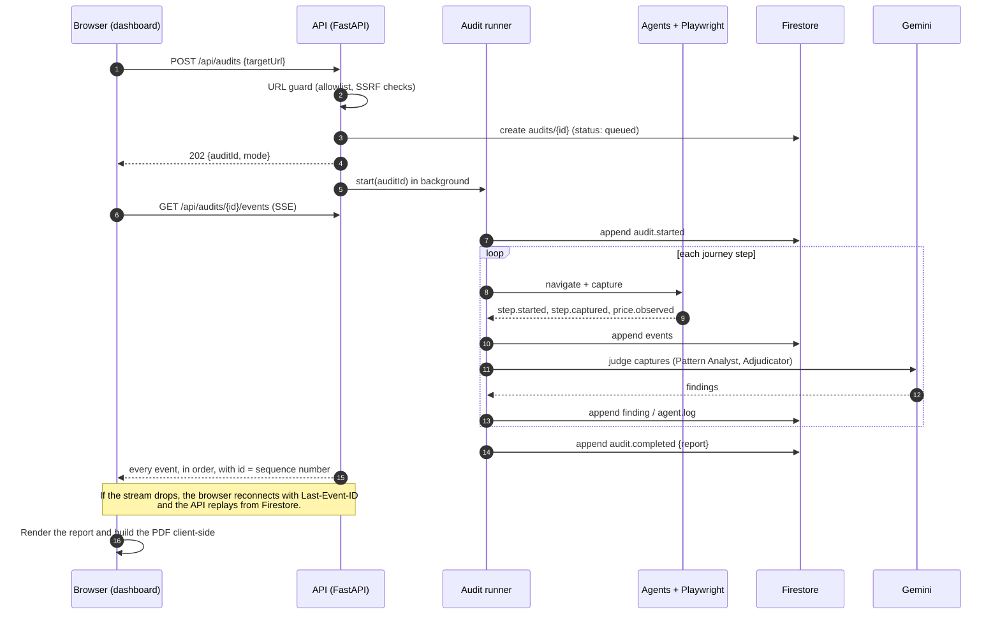
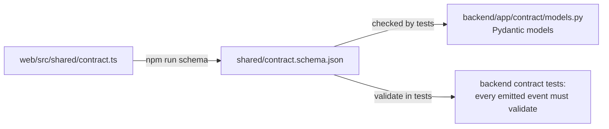

# Shop Honest: Architecture

> Status: **Phases 1–5 built and deployed.** Real stores are audited logged-out by a general navigator ([ADR-0013](decisions/0013-general-navigator-on-third-party-stores.md)), and accuracy is measured on a public dataset as well as our own stores. The API with a resumable stream and replay mode; live audits where a headless Chromium walks the store and measured checks find what can be measured ([ADR-0008](decisions/0008-measured-checks-before-judgement.md)); ADK agents on Gemini that judge each screen, with every claim grounded and verified ([ADR-0009](decisions/0009-grounded-and-verified-model-claims.md)); and a Price Historian on BigQuery that grows with every audit ([ADR-0012](decisions/0012-price-history-in-bigquery.md)). **Deployed:** <https://shop-honest-ai.web.app> runs on the real backend: Cloud Run in Mumbai, Firestore and Cloud Storage, with Gemini on Vertex AI judging live audits (§13). "Scan it" replays recorded runs; "Run live" audits the store for real, rate-limited. This document describes the system and how the parts fit together.
>
> Related: [API reference](API.md) · [Decision records](decisions/README.md)

## Contents
1. [Purpose and scope](#1-purpose-and-scope)
2. [System context](#2-system-context)
3. [Components](#3-components)
4. [The agents](#4-the-agents)
5. [One audit, end to end](#5-one-audit-end-to-end)
6. [Contract and API](#6-contract-and-api)
7. [Data model](#7-data-model)
8. [Model providers](#8-model-providers)
9. [Demo strategy](#9-demo-strategy)
10. [Security and safety](#10-security-and-safety)
11. [Reliability and cost controls](#11-reliability-and-cost-controls)
12. [Quality and evaluation](#12-quality-and-evaluation)
13. [Environments and deployment](#13-environments-and-deployment)
14. [Repository structure](#14-repository-structure)
15. [Roadmap](#15-roadmap)
16. [Risks and open questions](#16-risks-and-open-questions)

---

## 1. Purpose and scope

Shop Honest sends AI agents shopping. Given a product URL, they walk the journey a customer would (product page, variant, cart, checkout, payment) and report every dark pattern they find. Each finding carries a screenshot, the rule it breaks in each region, a confidence score and a fix. The report also measures what shoppers actually pay versus what they were shown.

**Goals**
- Audit a shopping journey end to end and stream progress live to the dashboard.
- Produce findings that hold up: evidence and a rule citation, or the finding is not reported. Anything uncertain goes to a human.
- Measure accuracy against a known answer key (our two demo stores) and a public labelled dataset.
- Run on Google Cloud: Gemini on Vertex AI, ADK, Cloud Run, Firestore, Cloud Storage and BigQuery.

**Non-goals**
- Paying, placing orders, or creating accounts on audited sites. The agent always stops before payment.
- Bypassing CAPTCHAs, bot protection or sign-in walls. The agent stops and reports a partial audit.
- Auditing native mobile apps (a later phase).
- Giving legal advice. Exposure is shown as statutory maximums and real precedents, never as a prediction.

## 2. System context


The web app and the API share one origin through a Hosting rewrite, so there's no CORS in production and one link to share. The backend is a single Cloud Run service; audits run as background work inside it (see [ADR-0001](decisions/0001-python-adk-cloud-run.md)).

## 3. Components

| Component | Responsibility | Tech | Lives in |
|---|---|---|---|
| **Web app** (built) | Dashboard, live audit view, report, PDF, demo stores. Talks to the backend through `AuditSource` (`mock` today, `live` = SSE). | React 19, Vite, Tailwind, react-pdf | `web/` |
| **API service** | Validates and accepts audit requests, serves reports, streams events (SSE with resume). | FastAPI, Uvicorn | `backend/app/api/` |
| **Audit runner** | Owns one audit: creates the record, runs the agent pipeline step by step, enforces budgets, appends every event to the log, emits exactly one terminal event. | asyncio background task | `backend/app/runner/` |
| **Agents** | Navigate, judge, verify prices, assemble evidence, adjudicate, report. See [§4](#4-the-agents). | Google ADK | `backend/app/agents/` |
| **Browser layer** | Headless Chromium session per audit. Known stores use scripted journeys; other sites use Gemini-guided navigation. Captures a screenshot, a trimmed DOM/text snapshot and element bounding boxes for every screen. | Playwright (Python) | `backend/app/browser/` |
| **URL guard** | Allowlist, scheme check, DNS resolution with private/metadata IP blocking, re-check after redirects. | Python stdlib | `backend/app/browser/url_guard.py` |
| **Stores** | Audits and events (Firestore), screenshots (Cloud Storage), price history (BigQuery). Each has an in-memory/local-disk fallback for development. | google-cloud-* clients | `backend/app/stores/` |
| **Legal reference** | Per-region laws, penalty headlines, pattern → clause map and precedents. One JSON file shared with the web app. | JSON | `shared/legal.json` |
| **Model providers** | One switch for every agent: `replay`, `ollama` or `gemini`. | ADK + LiteLLM | `backend/app/models/` |

## 4. The agents

Each agent has one job and a typed output. Agents never call each other directly; the runner passes their outputs along. This keeps them testable one by one and makes the audit trail (`agent.log`) honest about who did what.

| Agent | Input | Output | Tools | Model tier |
|---|---|---|---|---|
| **Navigator** | Target URL, the journey so far | Next action; per-screen `Capture` (screenshot, text snapshot, element boxes, URL); `step.*` events; `price.observed` | Playwright: open, click, select, reload, read text, screenshot, measure element | **None** for scripted demo stores; **Flash** for unknown sites |
| **Pattern Analyst** | One or two captures (e.g. before and after a reload), price facts | Candidate findings: pattern, the cited element, observations, explanation, raw confidence | None (multimodal prompt, JSON-schema output) | **Pro** (accuracy matters most here) |
| **Price Historian** | Product key, advertised MRP and price | Price facts: what it really sold at, MRP changes, genuine discount; records today's price | BigQuery (`app/prices/`) | None: the query answers it |
| **Evidence** | Candidate finding and captures | Evidence frames: uploaded screenshot URLs, normalised bboxes, captions; rejects candidates it can't ground | Cloud Storage upload, bbox lookup | No model (deterministic) |
| **Adjudicator** | Grounded candidates | `Finding`s with final confidence and status: **confirmed** when ≥ 0.75, otherwise **needs_review**; duplicates merged | None | Flash |
| **Reporter** | All findings, price trail, coverage | `AuditReport`: summary, remediation per finding, `priceDrift`, `exposure` (from `shared/legal.json`) | Legal reference lookup | Flash |
| *Seller Trust* (later) | Seller/domain | Domain age, reused imagery, review anomalies | Vertex AI Search, WHOIS | Flash |

**Orchestration (per audit)**


Two observations need more than one screen: a timer that restarts, or stock that never moves. For these the Navigator deliberately takes a second look (wait, reload, change variant), and the Pattern Analyst is given both captures. That's the core of "this needs an agent, not a classifier".

**What runs today (Phase 2).** The Navigator walks the store with a scripted journey (`backend/app/journeys/`). After each capture, a generic extractor (`backend/app/browser/signals.js`) reads what a shopper can see: timers, stock claims, price and MRP, dialogs, checkboxes, cart lines, the order summary, fee disclosures and sign-in walls, each with a bounding box. Then measured checks run over everything seen so far (`backend/app/agents/checks.py`), so findings stream as soon as their evidence exists:

| Check | Pattern | Evidence |
|---|---|---|
| The countdown reads *later* after a reload | `false_urgency` | before and after frames |
| The same "only N left" on every look and variant | `false_urgency` | first look and another variant |
| Never sold at the advertised MRP across ≥ 8 weeks of history (BigQuery), and the discount is ≥ 10 points bigger than against the highest real price | `misleading_price` (Price Historian) | price block |
| The cart holds lines the agent never added | `basket_sneaking` | cart |
| A paid, recurring option is ticked on arrival | `subscription_trap` | checkout |
| Fees first appear at payment and weren't disclosed upfront | `drip_pricing` | product page and payment |

The deterministic Reporter (`backend/app/agents/reporter.py`) builds the report: trust score, summary, coverage, `priceDrift` from the order-summary rows each step showed, and `exposure` from `shared/legal.json`. **Model judgement (Phase 3).** Patterns that need judgement (wording, button prominence, unverifiable claims) go through three agents, in the background so navigation never waits for a model ([ADR-0009](decisions/0009-grounded-and-verified-model-claims.md)):

1. **Element list** (`agents/elements.py`): each screen becomes a numbered list (`e1, e2…`) of dialogs and their buttons, controls, claims, persuasive notes and checkboxes, each with measured facts ("text link, grey text, 12 px, 198×16 px"). Anything a measured finding already covers is left out.
2. **Pattern Analyst** (`agents/pattern_analyst.py`, *smart* tier, ADK `LlmAgent`): sees the screenshot and the list, and returns candidates that cite element refs, never coordinates. Claims nobody can check from the page are marked `verifiable: false`.
3. **Evidence** (`agents/evidence.py`, no model): grounds each candidate on the cited elements (box, element text and observations all come from measurement) and drops claims the measurements contradict. For example, interface interference needs two options whose measured sizes differ at least 3×, and false urgency must rest on a claim, not a button.
4. **Adjudicator** (`agents/adjudicator.py`, *fast* tier): scores agreement from a crop of the evidence. Below 0.35 the claim is dropped. Unverifiable claims go to human review without a verifier, since a second model can't settle them either. Otherwise the lower of the two scores decides: ≥ 0.75 confirmed, below that human review.

Every decision is narrated in the audit trail, including the claims that were dropped and why. A model that times out or answers nonsense costs that screen its review, never the audit (`models/call.py`).

**The agent graph (ADR-0014).** The audit runs as two ADK `Workflow` graphs:
- **`audit`** (`runner/audit_graph.py`): navigate → collect reviews → summarise → report.
- **`screen_review`** (`agents/review_graph.py`), one session per screen: prepare → analyse → ground → adjudicate. Routes skip the rest when there's nothing to judge.

The Pattern Analyst and the Adjudicator run as child agents of their nodes, and model budgets are enforced inside the model (`models/metered.py`). Before ruling, the Adjudicator runs the one check that can settle the claim (`agents/tools.py`):
- interface interference: `measure_elements`;
- false urgency on the product page: `compare_reloads`;
- nagging: `find_on_other_screens`.

Wording claims are ruled on directly. Each tool call appears in the agent log with a chip. `AGENT_GRAPH=false` runs the same steps without the graphs.

**"Fix it" (ADR-0015)** is a separate step after the audit.
- **Proposing:** `POST /api/audits/{id}/fixes` asks the **Fixer** (`agents/fixer.py`) once for a finished audit. On stores whose settings we control (the demo stores, `shared/store_settings.json`), it writes settings changes, each checked against the dark patterns that setting can fix. Every finding gets a kind: `setting`, `code` or `review`.
- **Projecting:** the web app recalculates the report's numbers as fixes are switched on (`web/src/auditor/projection.ts`).
- **Verifying:** `POST /api/audits` with `compareTo` and `applyFixes` runs a live audit whose browser writes the patch to sessionStorage before the page loads, so only that browser sees the fixed copy. Its prices are never recorded. The report gets `appliedFixes` and a `comparison` with the earlier audit.
- **Re-auditing:** `compareTo` alone re-audits a page (real sites included) and compares, which is the "Re-audit this page" button.

## 5. One audit, end to end



Event ordering rules (enforced by the runner and checked in tests):
- `audit.started` comes first. Exactly one terminal event, `audit.completed` or `audit.failed`, comes last.
- Within a step: `step.started` → captures and logs → `price.observed` → findings.
- `step.blocked` ends the walk. No later `step.started` follows it.

## 6. Contract and API

`web/src/shared/contract.ts` is the **single source of truth** for every payload ([ADR-0006](decisions/0006-contract-source-of-truth.md)):



Endpoints (full details in [API.md](API.md)):

| Method | Path | Purpose |
|---|---|---|
| `POST` | `/api/audits` | Start an audit → `{auditId, mode}` |
| `GET` | `/api/audits/{id}` | Status and the final report (for reloads and shared links) |
| `GET` | `/api/audits/{id}/events` | Server-sent events, resumable |
| `GET` | `/api/audits/{id}/frames/{n}.jpg` | Screenshots captured by a live audit |
| `POST` | `/api/audits/{id}/fast-forward` | Skip to the end of a replay |
| `GET` | `/api/health` | Liveness for Cloud Run |

The client is `web/src/auditor/source/sseSource.ts`. Production builds use it (`web/.env.production`), wrapped so that a sample-store scan falls back to the built-in demo replay if the API can't be reached at all. Hosting forwards `/api/**` to Cloud Run, except the event stream, which the browser reads from Cloud Run directly because Hosting buffers streams ([ADR-0010](decisions/0010-event-stream-straight-to-cloud-run.md)).

## 7. Data model

**Firestore**

| Path | Fields |
|---|---|
| `audits/{auditId}` | `status` (queued · running · completed · failed), `mode` (replay · live), `targetUrl`, `createdAt`, `startedAt`, `completedAt`, `report` (AuditReport, when completed), `error`, `budget` (counters used), `requester` (for rate limits) |
| `audits/{auditId}/events/{seq}` | `seq` (int, 1…n, also the SSE `id`), `type`, `payload` (the AuditEvent), `at` |

**Cloud Storage** (built): `gs://shop-honest-72fd8-audits/audits/{auditId}/frames/{n}.jpg`, JPEG at quality 82, deleted after 30 days by a lifecycle rule. The browser loads frames from `/api/audits/{id}/frames/{n}.jpg` through Hosting, so they stay same-origin for the PDF's canvas crops and need no signed URLs or bucket CORS. They're cached by the CDN.

**Firestore** (built, Native mode, `asia-south1`): audits, their events and the live-audit counters (`limits/…`) carry an `expireAt` with a TTL policy, so they delete themselves after 30 days (counters after 2).

**BigQuery** (built) dataset `shop_honest`, `asia-south1` ([ADR-0012](decisions/0012-price-history-in-bigquery.md)):

| Table | Columns |
|---|---|
| `price_history` | `product_key STRING`, `observed_at TIMESTAMP`, `price NUMERIC`, `mrp NUMERIC`, `currency STRING`, `source STRING` (`catalog` · `audit`), `audit_id STRING`; partitioned by day, clustered by `product_key` |

The demo catalog is seeded by `backend/scripts/seed_price_history.py` (from `shared/price_history.json`, dated relative to now). Every live audit adds the price and MRP it saw, so history grows for any product we audit. Real sites have no history until then; their MRP claims aren't judged without at least 8 weeks of it.

**Recordings** (`backend/app/replay/recordings/*.json`) are complete event logs of real runs, used by the replay mode ([§9](#9-demo-strategy)).

**Legal reference**: `shared/legal.json`, moved out of `web/src/auditor/mock/legal.ts`, so the web app and the backend read the same jurisdictions, citations and precedents.

## 8. Model providers

One setting switches every agent ([ADR-0003](decisions/0003-model-providers.md)):

| `MODEL_PROVIDER` | Uses | When | Cost |
|---|---|---|---|
| `replay` | No model: plays back a recorded run | UI work, infrastructure, CI, the public demo default | ₹0 |
| `ollama` | Gemma 3 (4B by default) on the developer's machine, through ADK's LiteLLM connector | Building agents, prompts and schemas offline | ₹0 |
| `gemini` | Gemini through **Vertex AI** on the global endpoint (`GEMINI_BACKEND=vertex`, the default; ADC locally, the service account on Cloud Run), or AI Studio with a key | Accuracy evals, "Run live", the deployed backend | about 21k input + 5k output tokens per Store A audit with `gemini-3.6-flash` and the agent graph |

- **Tiers:** a *fast* model (Flash class) for adjudication, and a *smart* model (Pro class) for the Pattern Analyst. Ollama serves both tiers with one model. Model IDs are configuration, not code (`GEMINI_MODEL_FAST`, `GEMINI_MODEL_SMART`).
- **`replay` in a live audit** means no model: the audit is measured-only, exactly as in Phase 2.
- **Structured output:** every model call returns JSON validated against a Pydantic schema (`backend/app/models/call.py`). Invalid output is retried once; after that the screen goes without a model review, and the audit trail says so.
- **Prompt caching:** the system prompts and pattern guidance are passed as ADK `static_instruction` (no templating), which Gemini can cache.
- **Tests** use `ScriptedLlm`, an ADK model that answers from a Python function, so no test needs a network or a model.

## 9. Demo strategy

For the public site ([ADR-0004](decisions/0004-replay-and-run-live.md)):
- **"Scan it"** on a sample store replays a **recorded real run** (`mode: replay`). It costs nothing, starts instantly and can't fail on stage because of network or model latency. The UI states that it is a recorded run and when it was recorded.
- **"Run live"** starts a fresh audit with the real agents (`mode: live`). It is rate-limited and budget-capped.
- `backend/scripts/record.py` re-records the sample-store runs after agent changes, so replays always reflect the current agents. The committed recordings are **real runs** (2026-10-11, `gemini-3.8-flash`): Store A 9/9 with the unverifiable claim in review, B clean, C 6/6 before its wall. Their screenshots are served by Hosting from `web/public/recordings/`. To refresh them: `MODEL_PROVIDER=gemini uv run python -m scripts.record store-a store-b store-c`, check them with the answer key, then re-run with `--publish` (or copy from `backend/var/recordings/`). The web app's own offline demo (`npm run dev`, and the fallback when the API is down) still uses the scripted mock.
- Three sample stores: **A** (rigged), **B** (honest control) and **C** (A behind a sign-in wall at checkout). C shows the partial-audit path: the Navigator stops at the wall, says so, and reports on the steps it reached.

## 10. Security and safety

A user-supplied URL makes **our** browser visit it, so every request goes through the URL guard ([ADR-0005](decisions/0005-allowlist-and-safety.md)):

| Threat | Control |
|---|---|
| SSRF: reaching internal services or the cloud metadata server | Only `http`/`https`. Resolve DNS and reject private, loopback, link-local and metadata IP ranges. Re-check every redirect and navigation inside Playwright (request interception). |
| Using us as a free crawler | **Daily cap** on live audits site-wide. `ALLOWED_HOSTS` is `*` (any public site) since 15 Oct 2026; a deployment can narrow it to named domains. |
| Surprise bills | Per-audit budgets ([§11](#11-reliability-and-cost-controls)), billing alerts. |
| Acting on a shopper's behalf | A click guard in code: never pay, buy now, confirm an order, sign in, register, subscribe or accept terms; never type. A sign-in wall, bot protection or an error page produces `step.blocked`, and the report shows a partial audit. We never get around CAPTCHAs. |
| Wrongly accusing a real company | On third-party sites, measured findings that depend on page layout go to human review, and reports carry an "automated observations, not a legal finding" note ([ADR-0013](decisions/0013-general-navigator-on-third-party-stores.md)). |
| Leaking secrets | Credentials (e.g. a platform's test account, later) live in Secret Manager. Nothing sensitive goes into events or logs. |
| Cross-site abuse | Same origin through Hosting. In development, CORS is limited to `CORS_ORIGINS`. |

## 11. Reliability and cost controls

**Budgets per audit** (configuration):

| Limit | Default | On breach |
|---|---|---|
| Journey steps visited | 5 (+ 3 retries) | Stop; partial audit |
| Model calls | 40 | Stop judging; report what is grounded |
| Model tokens | 400k | As above |
| Wall-clock time | 6 min | `audit.failed` with a clear reason |

- **Resumable stream:** events are persisted before they are sent, and SSE `id` is the sequence number. On reconnect the API replays everything after `Last-Event-ID`, so refreshes and flaky networks are harmless. Firebase Hosting turned out to buffer streams, so the browser reads the stream from Cloud Run directly ([ADR-0010](decisions/0010-event-stream-straight-to-cloud-run.md)). A client watchdog reopens a stream that has gone silent for 60 s.
- **Several instances:** the instance running an audit owns it and writes a heartbeat every 10 s. If the owner goes quiet for 45 s (crash, scale-in), the next request or quiet stream to reach any instance claims the audit atomically. A replay continues from the last stored event; a live audit is closed as `failed`. "Skip to report" is a flag on the audit, so it works from any instance ([ADR-0011](decisions/0011-audit-ownership-and-takeover.md)). The cap of 2 live browsers is per instance, by design.
- **Idempotency:** each audit has a single writer at a time, and events are create-only, so a takeover can't duplicate or overwrite them. Audits older than their time limit plus 2 minutes are closed as `failed` as a last resort.
- **Gemini capacity:** retries with backoff, then `gemini-3.1-flash-lite` as fallback; a screen whose review still fails is reported as such, and the audit completes on its measured findings.
- **Live-audit limits:** 100 per day site-wide (`429 rate_limited`). There is no per-visitor limit in production; `LIVE_PER_IP_PER_HOUR` can bring one back.
- **Alerts** (`deploy/monitoring.py`, by email to the project owner): any ERROR log from the service, and more than 3 5xx responses in 5 minutes. Both are free while nothing goes wrong. An uptime probe on `/api/health` runs only in judging mode, because probing every few minutes would keep an instance awake all the time (about $3 a day with CPU always allocated).
- **Judging days:** `deploy/judging.sh on` keeps one instance warm (no cold starts) and turns the uptime probe on; `off` puts both back. A warm instance costs money all day, so turn it off afterwards.
- **Rollback:** Cloud Run keeps earlier revisions, and Artifact Registry keeps the 3 newest images (so rollback reaches two releases back). List revisions with `gcloud run revisions list --service shop-honest-api --region asia-south1`, then `gcloud run services update-traffic shop-honest-api --region asia-south1 --to-revisions REVISION=100`.
- **Spend:** two billing budgets on the project: ₹2,000 a month after credits and ₹5,000 a month of usage before credits, alerting at 50/90/100%. They alert, they don't cap. Actual use so far: roughly ₹100 of the $300 credit, mostly the Gemini model comparison; a live audit with `gemini-3.8-flash` was about ₹1.5–2 (`gemini-3.6-flash`, the default since 15 Oct, hasn't been costed yet).

## 12. Quality and evaluation

| Check | What it proves | Target |
|---|---|---|
| **Answer-key eval** (`backend/evals/answer_key.py --provider … --runs N`) | Live audits of stores A, B and C against `shared/answer_key.json` (exported from `web/src/store/answerKey.ts`); recall spread over runs, false alarms, and whether claims meant for review went there | Target: A ≥ 8/9 with the borderline claim → `needs_review`, B 0 false alarms. **Gemini (2 runs per store, each of `gemini-3.8-flash`, `gemini-2.5-pro`, `gemini-3.1-pro-preview` as the analyst): A 9/9 · B 0 · C 6/6, review 2/2 every time**, so the cheapest (`gemini-3.8-flash`, both tiers) became the default. **15 Oct, with the agent graph:** `gemini-3.8-flash` slowed to 20–50 s a call on Vertex; `gemini-3.6-flash` scored the same (A 9/9 · B 0 · C 6/6, review 2/2, 2 runs) in 27 s per Store A audit and is now the default, with `gemini-3.1-flash-lite` (also A 9/9 · B 0 · C 6/6) as the fallback. Measured only: A 6/9 · B 0 · C 4/6. Gemma 3 4B (local): A 8/9 · B 0 · C 5/6. Findings that are real but not what a trick was planted for (the popup's lopsided buttons, "Most customers choose Express") are listed in the answer key's `ALSO_ACCEPTABLE` and count as neither hits nor false alarms; Store B has none. |
| **Dataset eval** (`backend/evals/dataset.py`) | The Pattern Analyst's judgement (same model and guidance) on the public ec-darkpattern texts: 2,356, half dark patterns, Mathur et al.'s categories | **Zero-shot, `gemini-3.6-flash`: accuracy 0.961, precision 0.997, recall 0.924, F1 0.959** (`gemini-3.8-flash`: F1 0.962). The paper's models trained on this dataset reach 0.960–0.975 F1. Recall per category (3.6 Flash): Scarcity 409/418, Social Proof 308/312, Urgency 205/210, Misdirection 143/195, Obstruction 15/27, Sneaking 7/12, Forced Action 2/4 |
| **Contract tests** | Every event the backend emits validates against `shared/contract.schema.json` | 100% |
| **Unit tests** | URL guard, request guard, every check (positive, and honest variants that must not trigger), price drift, report, exposure | — |
| **Browser tests** | Real live audits of the built web app (`pytest -m browser`): steps, findings, prices, every event against the schema, record → replay | — |
| **Golden recordings** | Replay output is byte-stable across releases | — |

The eval numbers go in the README and the pitch: real numbers instead of claims.

## 13. Environments and deployment

| Environment | Runs | Stores | Models |
|---|---|---|---|
| **Local** | `uv run uvicorn app.main:app` + `npm run dev` (web) | In memory + local disk (`STORE_BACKEND=memory`) | `replay` or `ollama` |
| **Cloud dev** | Cloud Run revision with a tag | Firestore, GCS, BigQuery | `gemini` via AI Studio key or Vertex |
| **Production** (live) | Cloud Run `shop-honest-api` in `asia-south1`, behind Hosting `/api/**`; the event stream direct | Firestore + Cloud Storage | `gemini-3.8-flash` via Vertex AI (global endpoint), `gemini-2.5-flash` as fallback |

**How it's deployed** (`deploy/`):
- `deploy/setup.sh` (once, safe to re-run) turns on the APIs and creates the Firestore database, the frames bucket, the Artifact Registry repository and the service account `shop-honest-api@…`. That account has only `aiplatform.user`, `datastore.user` and object admin on its own bucket.
- `deploy/backend.sh` builds `backend/Dockerfile` with Cloud Build and deploys it with `deploy/backend.env.yaml`. The image is the official Playwright Python image with uv and runs as a non-root user; Chromium matches the pinned Playwright.
- Hosting: `npx firebase-tools deploy --only hosting` (production build, `VITE_AUDIT_SOURCE=live`).
- `deploy/monitoring.py` (alerts) and `deploy/judging.sh on|off` (judging-day settings); see §11.

**Cloud Run settings:** 2 vCPU, 2 GiB, CPU always allocated (audits run after the POST returns), concurrency 20 (streams are mostly idle; live browsers are capped by `MAX_LIVE_AUDITS=2` per instance), max 3 instances, min 0 (set `--min-instances 1` on judging days), request timeout 15 min, gen2.

**Gemini resilience:** each model retries 408/429/5xx answers with backoff (2, 4, 8 s plus jitter). If the main model is still out of capacity, `gemini-3.1-flash-lite` answers instead (`GEMINI_MODEL_FALLBACK`). Live audits are capped at 3 per visitor per hour and 100 per day across the site.

**Configuration** (environment variables):

| Variable | Example | Purpose |
|---|---|---|
| `MODEL_PROVIDER` | `replay` · `ollama` · `gemini` | Which models the agents use |
| `GEMINI_BACKEND` | `vertex` · `ai_studio` | Gemini through Vertex AI (no key; ADC or the service account) or AI Studio |
| `GOOGLE_API_KEY` | (only with `ai_studio`) | AI Studio key |
| `GOOGLE_CLOUD_PROJECT` / `GOOGLE_CLOUD_LOCATION` | `shop-honest-72fd8` / `global` | Project; Gemini's endpoint (Mumbai only serves two Flash models) |
| `GEMINI_MODEL_FAST` / `GEMINI_MODEL_SMART` | `gemini-3.6-flash` / `gemini-3.6-flash` | Model tiers (chosen by the eval) |
| `AGENT_GRAPH` | `true` | Run the audit as ADK agent graphs ([ADR-0014](decisions/0014-audit-as-adk-workflow.md)); `false` runs the same steps in plain Python |
| `OLLAMA_BASE_URL` / `OLLAMA_MODEL` | `http://localhost:11434` / `gemma3:4b` | Local models |
| `STORE_BACKEND` | `memory` · `gcp` | In-process log + local frames, or Firestore + Cloud Storage |
| `PRICE_HISTORY_BACKEND` / `BQ_DATASET` | `json` · `bigquery` / `shop_honest` | Price history from the demo catalog file, or BigQuery (deployed) |
| `AUDIT_MAX_TOKENS` | `400000` | Model tokens (input + output) one audit may spend |
| `FRAMES_BUCKET` / `BQ_DATASET` | `shop-honest-72fd8-audits` / `shop_honest` | Storage names |
| `LIVE_PER_IP_PER_HOUR` / `LIVE_PER_DAY` | `0` / `100` (deployed; `0` = no limit) | Live-audit limits per visitor and for the whole site |
| `ALLOWED_HOSTS` | `*` · `shop-honest-ai.web.app,localhost` | Sites that can be audited: `*` is any public site; named hosts may resolve to private addresses in development |
| `ENABLE_LIVE` / `MAX_LIVE_AUDITS` | `true` / `2` | Live audits on or off; how many browsers at once |
| `NAV_LINGER_S` / `NAV_STEP_TIMEOUT_S` | `8` / `15` | Time on the product page before the second look; per-action timeout |
| `FRAMES_DIR` | `backend/var/frames` | Where live screenshots go until Cloud Storage |
| `AUDIT_MAX_STEPS` / `AUDIT_MAX_MODEL_CALLS` / `AUDIT_MAX_TOKENS` / `AUDIT_TIMEOUT_S` | `8` / `40` / `400000` / `360` | Budgets |
| `REVIEW_THRESHOLD` / `REJECT_BELOW` | `0.75` / `0.35` | Confirm at or above; drop a claim the verifier agrees with less than this |
| `ADJUDICATOR_VERIFY` | `true` | Second model call per claim, on a crop of its evidence |
| `MODEL_TIMEOUT_S` / `MODEL_CONCURRENCY` | `90` / `2` | Per-call limit; model calls in flight per audit |
| `CORS_ORIGINS` | `http://localhost:5173` | Development only |

**Web app:** `VITE_AUDIT_SOURCE=live` switches to the backend; `VITE_STREAM_BASE` is where the event stream comes from (the Cloud Run URL in production, ADR-0010).

## 14. Repository structure

```
shophonest/
├── web/                         # React app: dashboard, report, PDF, demo store (built)
├── backend/                     # ✓ = built
│   ├── pyproject.toml           # ✓ uv, Python 3.12
│   ├── Dockerfile               # Playwright Python base image (deploy phase)
│   ├── app/
│   │   ├── main.py              # ✓ FastAPI app and route wiring
│   │   ├── config.py            # ✓ settings from environment variables
│   │   ├── knowledge.py         # ✓ loads shared/*.json (patterns, legal, price history)
│   │   ├── api/                 # ✓ audits.py: POST, GET, SSE events, frames; health
│   │   ├── contract/            # ✓ Pydantic models mirroring contract.ts
│   │   ├── runner/              # ✓ runner.py (replay + live), walk.py (what a journey drives)
│   │   ├── journeys/            # ✓ scripted journeys for known stores (bazaarnest.py)
│   │   ├── agents/              # ✓ checks.py, elements.py, pattern_analyst.py, evidence.py,
│   │   │   └── prompts/         # ✓   adjudicator.py, judge.py, reporter.py; prompt templates
│   │   ├── browser/             # ✓ session.py (request guard), capture.py, signals.js, url_guard.py
│   │   ├── models/              # ✓ provider factory (replay | ollama | gemini), call helper, ScriptedLlm
│   │   ├── stores/              # ✓ in-memory event log, local frames; firestore, gcs, bigquery later
│   │   └── replay/              # ✓ recordings/*.json and the replay player
│   ├── scripts/                 # ✓ record.py, capture_signals.py; seed_bigquery.py later
│   ├── tests/                   # ✓ unit, contract and browser tests; fixtures/ = real signals
│   └── evals/                   # ✓ answer_key.py; dataset.py later
├── shared/                      # contract.schema.json (generated); legal, patterns, price_history,
│                                #   answer_key .json (exported by `npm run knowledge`)
├── docs/                        # this document, API.md, decisions/
└── firebase.json                # Hosting (+ /api/** rewrite to Cloud Run)
```

## 15. Roadmap

| Phase | Scope | Done when |
|---|---|---|
| **0. Setup** | Python 3.12 (uv), gcloud CLI, billing on `shop-honest-72fd8` (Blaze), enable Run, Vertex AI, Firestore, Storage, BigQuery, Secret Manager, Artifact Registry; Ollama + `gemma3:4b` | `uv run pytest` passes; `gcloud` authenticated |
| **1. Skeleton** ✓ | FastAPI with all endpoints, memory store, resumable SSE, `replay` provider playing the current mock runs, contract tests; deploy to Cloud Run with the Hosting rewrite | shop-honest-ai.web.app runs with `VITE_AUDIT_SOURCE=live` end to end. **Done** 2026-10-11 |
| **2. Navigator** ✓ | Playwright journeys for stores A, B and C (ported from `web/scripts/capture-screens.ts`), real screenshots (local disk; GCS at deploy), real `step.*` and `price.observed` events, measured checks and a deterministic report, store C's sign-in wall, "Run live" in the UI | A live run streams real screenshots and prices. **Done:** A 6/9, B 0 false alarms, C partial at the wall |
| **3. Pattern Analyst** ✓ | ADK Pattern Analyst + Evidence rules + Adjudicator, prompts and schemas, scripted model for tests, answer-key eval with runs | Store A ≥ 8/9, store B 0 false positives, measured with Gemini. **Done:** A 9/9, B 0, C 6/6 (`gemini-3.8-flash`) |
| **4. Price & report** ✓ | BigQuery seeding + Price Historian; Reporter (summary, remediation, exposure from `shared/legal.json`); budgets; recordings refreshed | Live report has the same shape as the mock; PDF works on live data. **Done:** the report and PDF on live data, specific fixes per finding, Firestore and Storage, the BigQuery Price Historian (recording every audit's prices), live-audit limits, model-call and token budgets, real recordings |
| **5. Hardening** ✓ | A general navigator on real stores logged out (AutomationExercise, Flipkart best effort), the dataset eval, billing alerts, judging mode, a pre-flight check, a judging runbook | Eval numbers in the README; demo rehearsed ([JUDGING.md](JUDGING.md)) |

## 16. Risks and open questions

| Risk | Impact | Mitigation |
|---|---|---|
| **Navigating real sites** is far harder than our demo store | Live audits of real sites stall | Scripted journeys for the demo; Gemini-guided navigation with a step budget for others; partial audits are reported honestly |
| **Bot protection** on large marketplaces | Blocked or misleading pages | Don't evade it. Owner mode (the platform provides a test account) is the intended production path |
| **No price history** for sites we have never observed | Price Historian can't judge inflated MRPs | Report "no history" instead of guessing; build history by re-auditing over time |
| **Legal clauses not all confirmed** | A wrong citation would hurt credibility | `verified: false` marks them in the UI and PDF; confirm against official texts before the final submission |
| **Hosting → Cloud Run timeout** on long streams | The live stream drops mid-audit | Resume by `Last-Event-ID` (by design), or stream directly from Cloud Run |
| **Model output drift** (invalid JSON, hallucinated elements) | Wrong or ungrounded findings | Schema validation, Evidence agent rejects anything it can't locate on the page, Adjudicator threshold |
