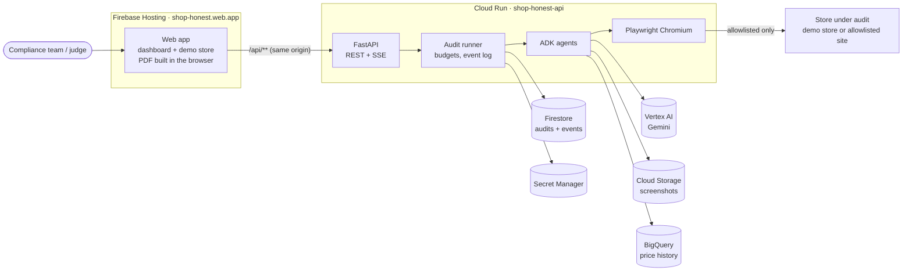
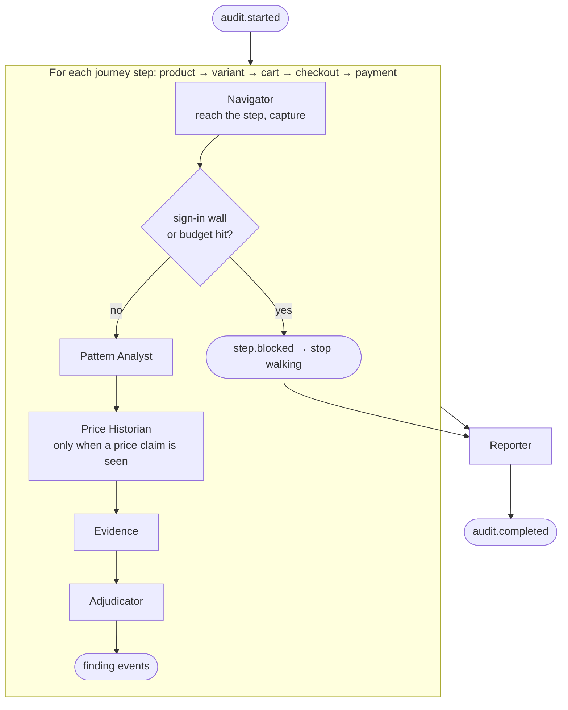
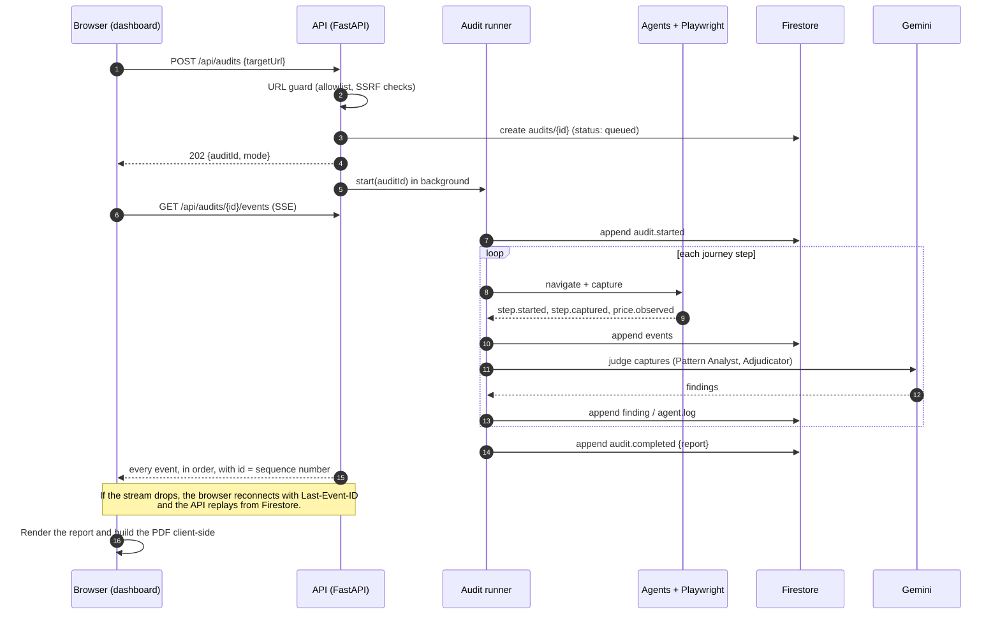
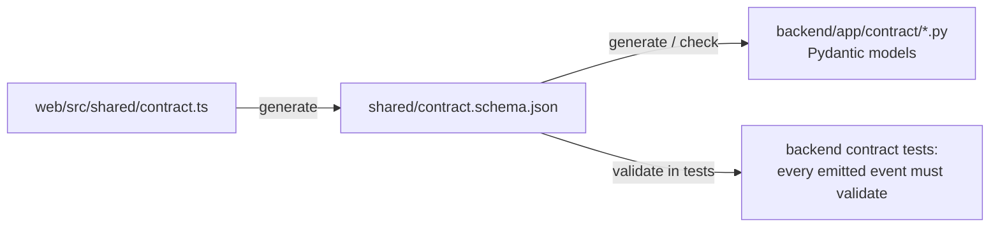

# Shop Honest: Architecture

> Status: **design, backend not yet built.** The web app (dashboard and demo store) is live at <https://shop-honest.web.app> and runs on a scripted mock. This document describes the backend we are building behind it, and how the two fit together.
>
> Related: [API reference](API.md) · [Decision records](decisions/README.md)

## Contents
1. [Purpose and scope](#1-purpose-and-scope)
2. [System context](#2-system-context)
3. [Components](#3-components)
4. [The agents](#4-the-agents)
5. [One audit, end to end](#5-one-audit-end-to-end)
6. [Contract and API](#6-contract-and-api)
7. [Data model](#7-data-model)
8. [Model providers](#8-model-providers)
9. [Demo strategy](#9-demo-strategy)
10. [Security and safety](#10-security-and-safety)
11. [Reliability and cost controls](#11-reliability-and-cost-controls)
12. [Quality and evaluation](#12-quality-and-evaluation)
13. [Environments and deployment](#13-environments-and-deployment)
14. [Repository structure](#14-repository-structure)
15. [Roadmap](#15-roadmap)
16. [Risks and open questions](#16-risks-and-open-questions)

---

## 1. Purpose and scope

Shop Honest sends AI agents shopping. Given a product URL, they walk the journey a customer would (product page, variant, cart, checkout, payment) and report every dark pattern they find. Each finding carries a screenshot, the rule it breaks in each region, a confidence score and a fix. The report also measures what shoppers actually pay versus what they were shown.

**Goals**
- Audit a shopping journey end to end and stream progress live to the dashboard.
- Produce findings that hold up: evidence and a rule citation, or the finding is not reported. Anything uncertain goes to a human.
- Measure accuracy against a known answer key (our two demo stores) and a public labelled dataset.
- Run on Google Cloud: Gemini on Vertex AI, ADK, Cloud Run, Firestore, Cloud Storage and BigQuery.

**Non-goals**
- Paying, placing orders, or creating accounts on audited sites. The agent always stops before payment.
- Bypassing CAPTCHAs, bot protection or sign-in walls. The agent stops and reports a partial audit.
- Auditing native mobile apps (a later phase).
- Giving legal advice. Exposure is shown as statutory maximums and real precedents, never as a prediction.

## 2. System context



The web app and the API share one origin through a Hosting rewrite, so there's no CORS in production and one link to share. The backend is a single Cloud Run service; audits run as background work inside it (see [ADR-0001](decisions/0001-python-adk-cloud-run.md)).

## 3. Components

| Component | Responsibility | Tech | Lives in |
|---|---|---|---|
| **Web app** (built) | Dashboard, live audit view, report, PDF, demo stores. Talks to the backend through `AuditSource` (`mock` today, `live` = SSE). | React 19, Vite, Tailwind, react-pdf | `web/` |
| **API service** | Validates and accepts audit requests, serves reports, streams events (SSE with resume). | FastAPI, Uvicorn | `backend/app/api/` |
| **Audit runner** | Owns one audit: creates the record, runs the agent pipeline step by step, enforces budgets, appends every event to the log, emits exactly one terminal event. | asyncio background task | `backend/app/runner/` |
| **Agents** | Navigate, judge, verify prices, assemble evidence, adjudicate, report. See [§4](#4-the-agents). | Google ADK | `backend/app/agents/` |
| **Browser layer** | Headless Chromium session per audit. Known stores use scripted journeys; other sites use Gemini-guided navigation. Captures a screenshot, a trimmed DOM/text snapshot and element bounding boxes for every screen. | Playwright (Python) | `backend/app/browser/` |
| **URL guard** | Allowlist, scheme check, DNS resolution with private/metadata IP blocking, re-check after redirects. | Python stdlib | `backend/app/browser/url_guard.py` |
| **Stores** | Audits and events (Firestore), screenshots (Cloud Storage), price history (BigQuery). Each has an in-memory/local-disk fallback for development. | google-cloud-* clients | `backend/app/stores/` |
| **Legal reference** | Per-region laws, penalty headlines, pattern → clause map and precedents. One JSON file shared with the web app. | JSON | `shared/legal.json` |
| **Model providers** | One switch for every agent: `replay`, `ollama` or `gemini`. | ADK + LiteLLM | `backend/app/models/` |

## 4. The agents

Each agent has one job and a typed output. Agents never call each other directly; the runner passes their outputs along. This keeps them testable one by one and makes the audit trail (`agent.log`) honest about who did what.

| Agent | Input | Output | Tools | Model tier |
|---|---|---|---|---|
| **Navigator** | Target URL, the journey so far | Next action; per-screen `Capture` (screenshot, text snapshot, element boxes, URL); `step.*` events; `price.observed` | Playwright: open, click, select, reload, read text, screenshot, measure element | **None** for scripted demo stores; **Flash** for unknown sites |
| **Pattern Analyst** | One or two captures (e.g. before and after a reload), price facts | Candidate findings: pattern, the cited element, observations, explanation, raw confidence | None (multimodal prompt, JSON-schema output) | **Pro** (accuracy matters most here) |
| **Price Historian** | Product identifier, advertised MRP and price | Price facts: past selling prices, MRP changes, genuine discount | BigQuery query tool | Flash (or no model, if the query alone answers it) |
| **Evidence** | Candidate finding and captures | Evidence frames: uploaded screenshot URLs, normalised bboxes, captions; rejects candidates it can't ground | Cloud Storage upload, bbox lookup | No model (deterministic) |
| **Adjudicator** | Grounded candidates | `Finding`s with final confidence and status: **confirmed** when ≥ 0.75, otherwise **needs_review**; duplicates merged | None | Flash |
| **Reporter** | All findings, price trail, coverage | `AuditReport`: summary, remediation per finding, `priceDrift`, `exposure` (from `shared/legal.json`) | Legal reference lookup | Flash |
| *Seller Trust* (later) | Seller/domain | Domain age, reused imagery, review anomalies | Vertex AI Search, WHOIS | Flash |

**Orchestration (per audit)**



Two observations need more than one screen: a timer that restarts, or stock that never moves. For these the Navigator deliberately takes a second look (wait, reload, change variant), and the Pattern Analyst is given both captures. That's the core of "this needs an agent, not a classifier".

## 5. One audit, end to end



Event ordering rules (enforced by the runner and checked in tests):
- `audit.started` comes first. Exactly one terminal event, `audit.completed` or `audit.failed`, comes last.
- Within a step: `step.started` → captures and logs → `price.observed` → findings.
- `step.blocked` ends the walk. No later `step.started` follows it.

## 6. Contract and API

`web/src/shared/contract.ts` is the **single source of truth** for every payload ([ADR-0006](decisions/0006-contract-source-of-truth.md)):



Endpoints (full details in [API.md](API.md)):

| Method | Path | Purpose |
|---|---|---|
| `POST` | `/api/audits` | Start an audit → `{auditId, mode}` |
| `GET` | `/api/audits/{id}` | Status and the final report (for reloads and shared links) |
| `GET` | `/api/audits/{id}/events` | Server-sent events, resumable |
| `GET` | `/api/health` | Liveness for Cloud Run |

The frontend already ships the client (`web/src/auditor/source/sseSource.ts`). Switching the deployed site to the backend is `VITE_AUDIT_SOURCE=live`.

## 7. Data model

**Firestore**

| Path | Fields |
|---|---|
| `audits/{auditId}` | `status` (queued · running · completed · failed), `mode` (replay · live), `targetUrl`, `createdAt`, `startedAt`, `completedAt`, `report` (AuditReport, when completed), `error`, `budget` (counters used), `requester` (for rate limits) |
| `audits/{auditId}/events/{seq}` | `seq` (int, 1…n, also the SSE `id`), `type`, `payload` (the AuditEvent), `at` |

**Cloud Storage**: `gs://<bucket>/audits/{auditId}/frames/{n}.jpg`. JPEG at quality 82, served to the browser by signed URL. The bucket needs a CORS rule for the site origin, because the PDF builder crops the screenshots on a canvas.

**BigQuery** dataset `shop_honest`:

| Table | Columns |
|---|---|
| `price_history` | `product_url STRING`, `observed_at TIMESTAMP`, `price NUMERIC`, `mrp NUMERIC`, `currency STRING`, `source STRING` |

Seeded from `web/src/store/catalog.ts` for the demo stores. Real sites only have history if we have observed them before, or have a data source (see [§16](#16-risks-and-open-questions)).

**Recordings** (`backend/app/replay/recordings/*.json`) are complete event logs of real runs, used by the replay mode ([§9](#9-demo-strategy)).

**Legal reference**: `shared/legal.json`, moved out of `web/src/auditor/mock/legal.ts`, so the web app and the backend read the same jurisdictions, citations and precedents.

## 8. Model providers

One setting switches every agent ([ADR-0003](decisions/0003-model-providers.md)):

| `MODEL_PROVIDER` | Uses | When | Cost |
|---|---|---|---|
| `replay` | No model: plays back a recorded run | UI work, infrastructure, CI, the public demo default | ₹0 |
| `ollama` | Gemma 3 (4B by default) on the developer's machine, through ADK's LiteLLM connector | Building agents, prompts and schemas offline | ₹0 |
| `gemini` | Gemini through the Google AI Studio free tier in development; **Vertex AI** in production | Accuracy evals, "Run live", the deployed backend | ~₹15–40 per audit |

- **Tiers:** a *fast* model (Flash class) for navigation, adjudication and reporting, and a *smart* model (Pro class) for the Pattern Analyst. Model IDs are configuration, not code (`GEMINI_MODEL_FAST`, `GEMINI_MODEL_SMART`).
- **Structured output:** every model call returns JSON validated against a Pydantic schema. Invalid output is retried once, then the candidate is dropped and logged.
- **Prompt caching:** stable system prompts and pattern definitions are cached to cut input cost.

## 9. Demo strategy

For the public site ([ADR-0004](decisions/0004-replay-and-run-live.md)):
- **"Scan it"** on a sample store replays a **recorded real run** (`mode: replay`). It costs nothing, starts instantly and can't fail on stage because of network or model latency. The UI states that it is a recorded run and when it was recorded.
- **"Run live"** starts a fresh audit with the real agents (`mode: live`). It is rate-limited and budget-capped.
- `backend/scripts/record.py` re-records the sample-store runs after agent changes, so replays always reflect the current agents.

## 10. Security and safety

A user-supplied URL makes **our** browser visit it, so every request goes through the URL guard ([ADR-0005](decisions/0005-allowlist-and-safety.md)):

| Threat | Control |
|---|---|
| SSRF: reaching internal services or the cloud metadata server | Only `http`/`https`. Resolve DNS and reject private, loopback, link-local and metadata IP ranges. Re-check every redirect and navigation inside Playwright (request interception). |
| Using us as a free crawler | **Allowlist** (`ALLOWED_HOSTS`): the demo store plus approved domains. Per-requester rate limit. |
| Surprise bills | Per-audit budgets ([§11](#11-reliability-and-cost-controls)), billing alerts. |
| Acting on a shopper's behalf | Never submit payment, never create accounts, never solve CAPTCHAs. A sign-in wall produces `step.blocked`, and the report shows a partial audit. |
| Leaking secrets | Credentials (e.g. a platform's test account, later) live in Secret Manager. Nothing sensitive goes into events or logs. |
| Cross-site abuse | Same origin through Hosting. In development, CORS is limited to `CORS_ORIGINS`. |

## 11. Reliability and cost controls

**Budgets per audit** (configuration):

| Limit | Default | On breach |
|---|---|---|
| Journey steps visited | 5 (+ 3 retries) | Stop; partial audit |
| Model calls | 40 | Stop judging; report what is grounded |
| Model tokens | 400k | As above |
| Wall-clock time | 6 min | `audit.failed` with a clear reason |

- **Resumable stream:** events are persisted before they are sent, and SSE `id` is the sequence number. On reconnect the API replays everything after `Last-Event-ID`. This makes refreshes, flaky networks and proxy timeouts harmless. One risk to verify early: Firebase Hosting rewrites to Cloud Run may cut long requests (we believe at about 60 s). If so, the browser either reconnects automatically (fine, given resume) or streams straight from the Cloud Run URL.
- **Idempotency:** the runner is the only writer of an audit's events. A crashed instance marks the audit `failed` on the next read after a timeout. It doesn't silently restart halfway.
- **Cold starts:** Chromium makes the container heavy. `min-instances=1` only on judging days (about ₹110/day); otherwise scale to zero.
- **Spend:** a billing budget with alerts at $50 and $100. Expected total for the hackathon: **$65–135**, mostly Gemini, less with the free tiers.

## 12. Quality and evaluation

| Check | What it proves | Target |
|---|---|---|
| **Answer-key eval** (`backend/evals/answer_key.py`) | Run live agents on store A and B; compare with `web/src/store/answerKey.ts` | Store A: ≥ 7 of 8 violations caught, borderline claim → `needs_review`. Store B: **0** findings. |
| **Dataset eval** (`backend/evals/dataset.py`) | Pattern Analyst on the public ec-darkpattern text set (2,356 labelled texts) | Report F1 honestly; compare with the published baselines |
| **Contract tests** | Every event the backend emits validates against `shared/contract.schema.json` | 100% |
| **Unit tests** | URL guard, budgets, ordering rules, price drift, exposure builder | — |
| **Golden recordings** | Replay output is byte-stable across releases | — |

The eval numbers go in the README and the pitch: real numbers instead of claims.

## 13. Environments and deployment

| Environment | Runs | Stores | Models |
|---|---|---|---|
| **Local** | `uv run uvicorn app.main:app` + `npm run dev` (web) | In memory + local disk (`STORE_BACKEND=memory`) | `replay` or `ollama` |
| **Cloud dev** | Cloud Run revision with a tag | Firestore, GCS, BigQuery | `gemini` via AI Studio key or Vertex |
| **Production** | Cloud Run `shop-honest-api` behind Hosting `/api/**` | Firestore, GCS, BigQuery | `gemini` via Vertex AI; demo default `replay` |

**Cloud Run settings:** 2 vCPU, 4 GiB, CPU always allocated (audits run after the POST returns), concurrency 2, request timeout 15 min, region `asia-south1`. The image is built from the official Playwright Python base and stored in Artifact Registry.

**Configuration** (environment variables):

| Variable | Example | Purpose |
|---|---|---|
| `MODEL_PROVIDER` | `replay` · `ollama` · `gemini` | Which models the agents use |
| `GOOGLE_GENAI_USE_VERTEXAI` | `TRUE` | Gemini through Vertex AI (otherwise AI Studio) |
| `GOOGLE_API_KEY` | (Secret Manager) | AI Studio key for development |
| `GOOGLE_CLOUD_PROJECT` / `GOOGLE_CLOUD_LOCATION` | `shop-honest` / `asia-south1` | Project and region |
| `GEMINI_MODEL_FAST` / `GEMINI_MODEL_SMART` | Flash- / Pro-class model IDs | Model tiers |
| `OLLAMA_BASE_URL` / `OLLAMA_MODEL` | `http://localhost:11434` / `gemma3:4b` | Local models |
| `STORE_BACKEND` | `memory` · `gcp` | Local fallbacks or Google Cloud |
| `GCS_BUCKET` / `BQ_DATASET` | `shop-honest-audits` / `shop_honest` | Storage names |
| `ALLOWED_HOSTS` | `shop-honest.web.app,localhost` | URL allowlist |
| `AUDIT_MAX_STEPS` / `AUDIT_MAX_MODEL_CALLS` / `AUDIT_MAX_TOKENS` / `AUDIT_TIMEOUT_S` | `8` / `40` / `400000` / `360` | Budgets |
| `REVIEW_THRESHOLD` | `0.75` | Adjudicator cut-off |
| `CORS_ORIGINS` | `http://localhost:5173` | Development only |

**Web app:** `VITE_AUDIT_SOURCE=live` switches to the backend. `VITE_API_BASE` (optional) points the event stream straight at Cloud Run if the Hosting timeout bites.

## 14. Repository structure

```
shophonest/
├── web/                         # React app: dashboard, report, PDF, demo store (built)
├── backend/                     # planned
│   ├── pyproject.toml           # uv, Python 3.12
│   ├── Dockerfile               # Playwright Python base image
│   ├── app/
│   │   ├── main.py              # FastAPI app and route wiring
│   │   ├── config.py            # settings from environment variables
│   │   ├── api/                 # audits.py: POST, GET, SSE events; health
│   │   ├── contract/            # Pydantic models mirroring contract.ts
│   │   ├── runner/              # audit orchestration, budgets, event log, ordering rules
│   │   ├── agents/              # navigator, pattern_analyst, price_historian, evidence,
│   │   │   └── prompts/         #   adjudicator, reporter; prompt templates
│   │   ├── browser/             # Playwright session, capture, url_guard.py
│   │   │   └── journeys/        #   scripted journeys for known stores
│   │   ├── models/              # provider factory: replay | ollama | gemini
│   │   ├── stores/              # firestore, gcs, bigquery + in-memory fallbacks
│   │   ├── legal/               # loads shared/legal.json, builds exposure
│   │   └── replay/              # recordings/*.json and the replay player
│   ├── scripts/                 # record.py, seed_bigquery.py, export_schema.py
│   ├── tests/                   # unit + contract tests
│   └── evals/                   # answer_key.py, dataset.py
├── shared/                      # contract.schema.json (generated), legal.json
├── docs/                        # this document, API.md, decisions/
└── firebase.json                # Hosting (+ /api/** rewrite to Cloud Run)
```

## 15. Roadmap

| Phase | Scope | Done when |
|---|---|---|
| **0. Setup** | Python 3.12 (uv), gcloud CLI, billing on `shop-honest` (Blaze), enable Run, Vertex AI, Firestore, Storage, BigQuery, Secret Manager, Artifact Registry; Ollama + `gemma3:4b` | `uv run pytest` passes; `gcloud` authenticated |
| **1. Skeleton** | FastAPI with all endpoints, memory store, resumable SSE, `replay` provider playing the current mock runs, contract tests; deploy to Cloud Run with the Hosting rewrite | shop-honest.web.app runs with `VITE_AUDIT_SOURCE=live` end to end |
| **2. Navigator** | Playwright scripted journeys for stores A and B (ported from `web/scripts/capture-screens.ts`), real screenshots to GCS, real `step.*` and `price.observed` events | A live run streams real screenshots and prices |
| **3. Pattern Analyst** | Prompts and schemas with `ollama`, then `gemini`; Evidence + Adjudicator; answer-key eval | Store A ≥ 7/8, store B 0 false positives |
| **4. Price & report** | BigQuery seeding + Price Historian; Reporter (summary, remediation, exposure from `shared/legal.json`); budgets; recordings refreshed | Live report has the same shape as the mock; PDF works on live data |
| **5. Hardening** | One allowlisted real site logged-out (partial coverage path), dataset eval, billing alerts, judging-day settings | Eval numbers in the README; demo rehearsed |

## 16. Risks and open questions

| Risk | Impact | Mitigation |
|---|---|---|
| **Navigating real sites** is far harder than our demo store | Live audits of real sites stall | Scripted journeys for the demo; Gemini-guided navigation with a step budget for others; partial audits are reported honestly |
| **Bot protection** on large marketplaces | Blocked or misleading pages | Don't evade it. Owner mode (the platform provides a test account) is the intended production path |
| **No price history** for sites we have never observed | Price Historian can't judge inflated MRPs | Report "no history" instead of guessing; build history by re-auditing over time |
| **Legal clauses not all confirmed** | A wrong citation would hurt credibility | `verified: false` marks them in the UI and PDF; confirm against official texts before the final submission |
| **Hosting → Cloud Run timeout** on long streams | The live stream drops mid-audit | Resume by `Last-Event-ID` (by design), or stream directly from Cloud Run |
| **Model output drift** (invalid JSON, hallucinated elements) | Wrong or ungrounded findings | Schema validation, Evidence agent rejects anything it can't locate on the page, Adjudicator threshold |
